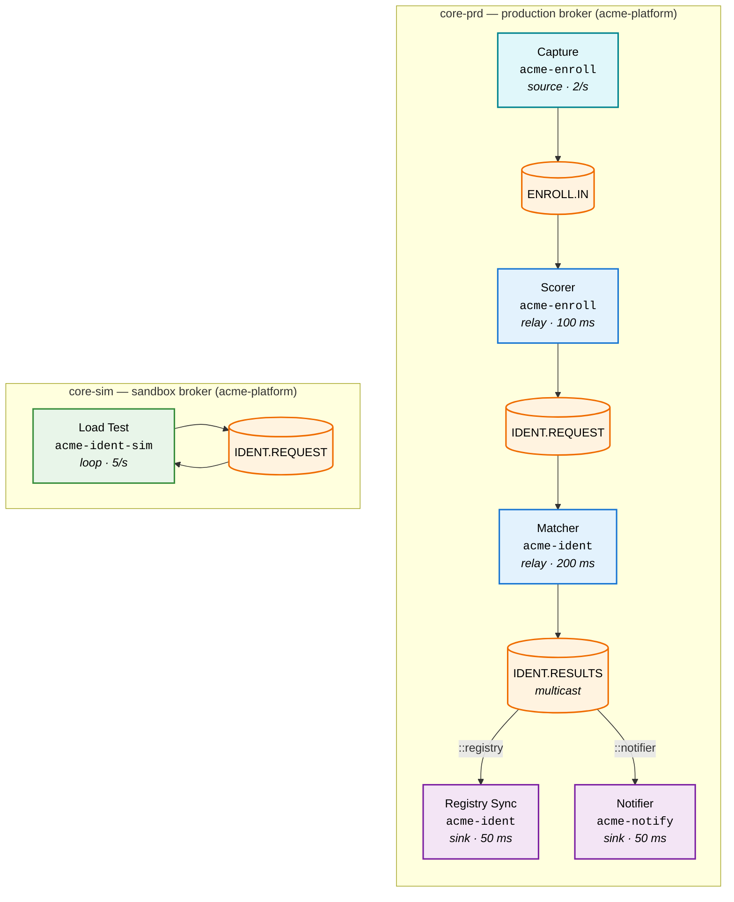
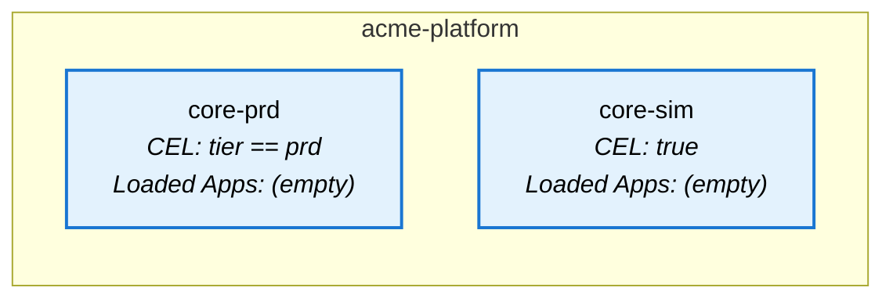
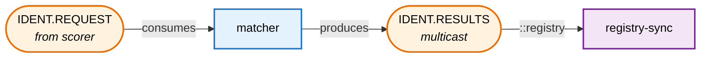
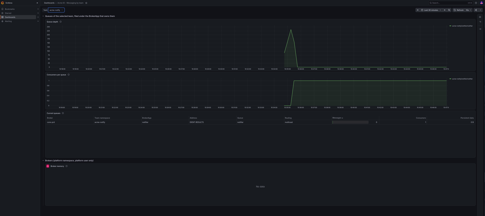
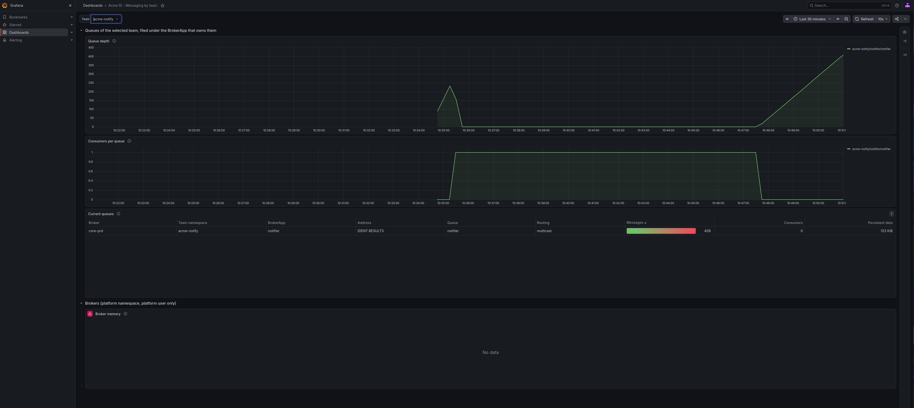
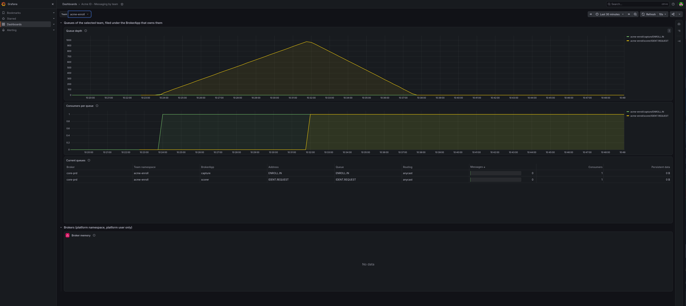
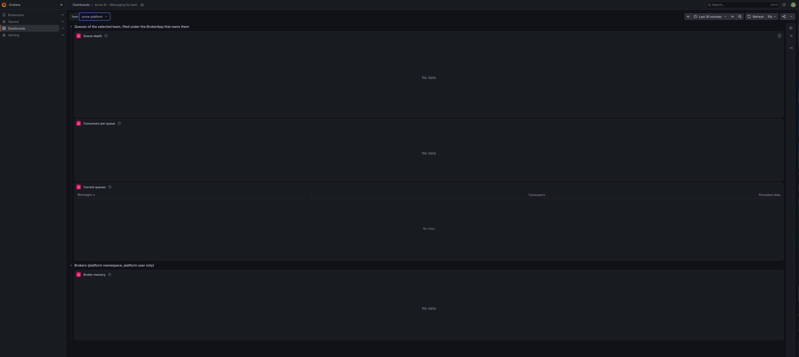
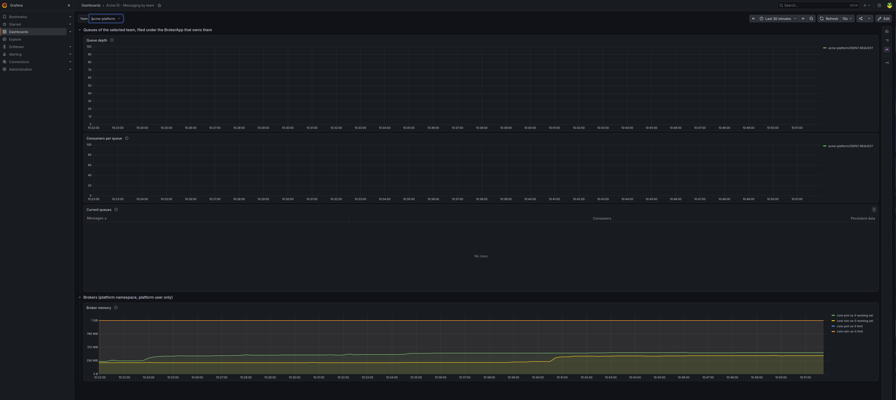
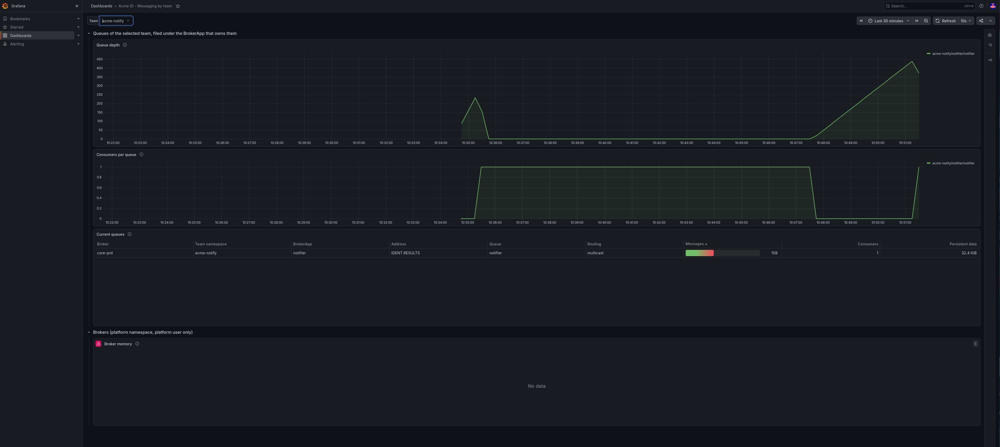

## 1. What We're Building

Acme ID verifies identities. Three teams build the pipeline, a platform team runs the brokers, and nobody files a ticket to get a queue. This tutorial builds that setup on a plain Kubernetes cluster and plays it **as the people involved**: every act starts by logging in as the team member who performs it, and the cluster answers with that person's rights. Identity comes from an OIDC provider (Keycloak) wired into the API server, so `alice` is a real user to Kubernetes, not an impersonation flag.

The pipeline processes identity cases through four stages, capture, scoring, matching and notification, connected through two BrokerServices managed by the ArkMQ Operator. A sandbox BrokerService lets a team load-test with the same address names without touching production, and a CEL authority gate shows that what an app asks for is not the same as what the platform grants.

Every queue metric the brokers export carries the namespace of the team that owns the queue. A tenancy proxy in front of Prometheus, the same two components OpenShift puts in front of its own monitoring, turns that label into access control: a team reads its queues, the platform reads everything. Grafana logs users in through the same provider and forwards each user's own token to that proxy, so a dashboard shows its viewer their queues and nothing else.

Every command in this document is executable and asserts what the text claims. The whole file runs unattended with [markdown-runner](https://github.com/arkmq-org/markdown-runner), which is how the operator's CI validates it.

Six requirements drive the design, one per act:

| # | Requirement | What it demonstrates |
|---|-------------|---------------------|
| R1 | The platform offers messaging as a service | `BrokerService` creation with CEL `appSelectorExpression` |
| R2 | Each team declares its apps without filing tickets | `BrokerApp` creation in team namespaces |
| R3 | One team hands a work stream to another | Cross-namespace anycast via `consumerOf` with `appNamespace` |
| R4 | One result reaches several independent readers | Multicast (`pubSub: true`) with durable subscriptions |
| R5 | Production only takes apps that explicitly ask for it | CEL reading the app's `spec.selector.matchLabels` |
| R6 | Each team sees its own queues, the platform sees everything | Metrics labelled per owning namespace, served through a tenancy proxy, charted in Grafana as each user |

### Architecture



**One image, seven roles.** The same container image (`acme-app`, a Camel Quarkus AMQP client) is deployed seven times. Role, destinations, and processing delay come from environment variables, so the image is never rebuilt.

| App | Namespace | Role | Consumes | Produces | Rate / Delay |
|-----|-----------|------|----------|----------|-------------|
| `capture` | `acme-enroll` | source | — | `ENROLL.IN` | 2/s |
| `scorer` | `acme-enroll` | relay | `ENROLL.IN` | `IDENT.REQUEST` | 100 ms |
| `matcher` | `acme-ident` | relay | `IDENT.REQUEST` | `IDENT.RESULTS` (topic) | 200 ms |
| `registry-sync` | `acme-ident` | sink | `IDENT.RESULTS::registry` | — | 50 ms |
| `notifier` | `acme-notify` | sink | `IDENT.RESULTS::notifier` | — | 50 ms |
| `loadtest` | `acme-ident-sim` | loop | `IDENT.REQUEST` | `IDENT.REQUEST` | 5/s |
| `loadtest-prd` | `acme-ident-sim` | loop | `SIM.PROBE` | `SIM.PROBE` | 1/s |

### Cast

Four users, one password (`acme-demo`), all declared in one Keycloak realm. Kubernetes RBAC is bound to their names.

| User | Team | Namespaces (admin) | Also allowed |
|------|------|--------------------|--------------|
| `platform` | Platform | `acme-platform` | read BrokerApps and metrics in every team namespace |
| `alice` | Enroll | `acme-enroll` | read the messaging catalog (BrokerServices, BrokerApps) everywhere |
| `bob` | Ident | `acme-ident`, `acme-ident-sim` | same |
| `carol` | Notify | `acme-notify` | same |

The cluster admin, the identity `minikube` gives you, only appears in the setup sections. Each act switches to the user who performs it with `kubectl config use-context <user>`, and switches back when it is done.

| Namespace | `env` label | Holds |
|-----------|-------------|-------|
| `acme-platform` | `platform` | `core-prd`, `core-sim`, Prometheus, Grafana, the tenancy proxy |
| `acme-enroll` | `prd` | `capture`, `scorer` |
| `acme-ident` | `prd` | `matcher`, `registry-sync` |
| `acme-notify` | `prd` | `notifier` |
| `acme-ident-sim` | `sim` | `loadtest`, `loadtest-prd` |
| `acme-auth` | | Keycloak |

### Prerequisites

- `minikube` with a VM driver (this tutorial starts its own profile, `acme-identity-pipeline`, and restarts it once to turn on OIDC)
- `kubectl`, `helm`, `curl`, `jq`
- A container build tool (`docker` or `podman`) to build the Camel image
- About 8 GB of RAM for the cluster (Keycloak alone needs 700 MB of it)

Several chunks end with `export`: the variables they set (`MINIKUBE_IP`, `ACME_ISSUER`, `ACME_CA`, `TOKEN`, …) are reused by every later chunk. If you type the commands by hand, run the exporting chunks in the same shell.

---

## 2. Setup Infrastructure

### Start Minikube

```bash {"stage":"init", "id":"minikube_start", "runtime":"bash"}
minikube start \
  --profile acme-identity-pipeline \
  --cpus 4 \
  --memory 8192 \
  --disk-size 20000
```
```shell markdown_runner
* [acme-identity-pipeline] minikube v1.37.0 sur Fedora 44
  - MINIKUBE_ROOTLESS=true
* Choix automatique du pilote kvm2. Autres choix: podman, qemu2, ssh
* Démarrage du nœud "acme-identity-pipeline" primary control-plane dans le cluster "acme-identity-pipeline"
* Configuration de bridge CNI (Container Networking Interface)...
* Vérification des composants Kubernetes...
  - Utilisation de l'image gcr.io/k8s-minikube/storage-provisioner:v5
* Modules activés: storage-provisioner, default-storageclass
* Terminé ! kubectl est maintenant configuré pour utiliser "acme-identity-pipeline" cluster et espace de noms "default" par défaut.
```

### Build the Acme App Image

The Acme app is a Camel Quarkus AMQP client ([`acme-app/`](acme-app/)) that connects to the broker over mTLS. Its role — source, relay, sink, or loop — is controlled entirely by environment variables. The `Containerfile` is a multi-stage build; no local JDK or Maven installation is required.

```bash {"stage":"init", "label":"build acme-app image", "rootdir":"$initial_dir", "runtime":"bash"}
CONTAINER_TOOL=$(command -v docker || command -v podman)
if [ -z "${CONTAINER_TOOL}" ]; then
  echo "Neither docker nor podman was found on PATH" >&2
  exit 1
fi

"${CONTAINER_TOOL}" build \
  -f docs/tutorials/acme-identity-pipeline/acme-app/Containerfile \
  docs/tutorials/acme-identity-pipeline/acme-app/ \
  -t acme-app:latest

ACME_IMAGE_TAR=$(mktemp -t acme-app-XXXXXX.tar)
"${CONTAINER_TOOL}" save acme-app:latest -o "${ACME_IMAGE_TAR}"
minikube image load "${ACME_IMAGE_TAR}" --profile acme-identity-pipeline
rm -f "${ACME_IMAGE_TAR}"

if minikube image ls --profile acme-identity-pipeline | grep -qx 'localhost/acme-app:latest'; then
  minikube image tag localhost/acme-app:latest acme-app:latest \
    --profile acme-identity-pipeline
fi
```
```shell markdown_runner
[1/2] STEP 1/8: FROM registry.access.redhat.com/ubi9/openjdk-21 AS builder
[1/2] STEP 2/8: USER root
--> Using cache f5d51ec399ae3afed6322933449be58086bbf7a393763f61bfeda2749e525346
--> f5d51ec399ae
[1/2] STEP 3/8: WORKDIR /build
--> Using cache 64d7160c98327337286c088fe319b13f42f76e3bd0f3a7cee91206418640a848
--> 64d7160c9832
[1/2] STEP 4/8: RUN microdnf install -y maven --setopt=install_weak_deps=0 && microdnf clean all
--> Using cache b00fb7724421584058d3e5b1cfab2538f00d7d2cfa6ed715c5501a3767cd5b97
--> b00fb7724421
[1/2] STEP 5/8: COPY pom.xml pom.xml
--> Using cache e1446ad175c73fb2d566b6b058e79bf0e1b135506246904adbc0a073e9e1b106
--> e1446ad175c7
[1/2] STEP 6/8: RUN mvn dependency:resolve-plugins dependency:resolve -q
--> Using cache ab1523b0d41caf6c6e745569af7a03e007e12a9e5525e3f6adcd02bf2d4bae94
--> ab1523b0d41c
[1/2] STEP 7/8: COPY src/ src/
--> Using cache 4b224fce8ed33e4014e7ea4f3609b9851b7bbdf9f1d97ca1ed9bb7ffcf82dbab
--> 4b224fce8ed3
[1/2] STEP 8/8: RUN mvn package -DskipTests -q
--> Using cache 6deee5620c96ef2c17c17291827dfd54367c4aab66521671abdfbdc4662aceba
--> 6deee5620c96
[2/2] STEP 1/11: FROM registry.access.redhat.com/ubi9/openjdk-21-runtime
[2/2] STEP 2/11: ENV LANGUAGE='en_US:en'
--> Using cache 5ab352ba2423876a77f348df6f4bd711a80c22d23414fe1d18213214b9ba888c
--> 5ab352ba2423
[2/2] STEP 3/11: COPY --chown=185 --from=builder /build/target/quarkus-app/lib/       /deployments/lib/
--> Using cache 0d7de41cdf6f3e05d289b47586ac19e9fbc65adedacb070f14a8abfd4d796cdf
--> 0d7de41cdf6f
[2/2] STEP 4/11: COPY --chown=185 --from=builder /build/target/quarkus-app/*.jar       /deployments/
--> Using cache e1973f46dd31c99469165abf065a8af8c527240ec649bd5528a126304b306505
--> e1973f46dd31
[2/2] STEP 5/11: COPY --chown=185 --from=builder /build/target/quarkus-app/app/        /deployments/app/
--> Using cache d932e43e67b10890027b7556550d4f0d6d30db5bd18ba8ac41bd0bfdc1d74593
--> d932e43e67b1
[2/2] STEP 6/11: COPY --chown=185 --from=builder /build/target/quarkus-app/quarkus/    /deployments/quarkus/
--> Using cache f9ed2611b040b0b84bdfcc39410883b14af139f9e8024f9b9bbb9757474765a6
--> f9ed2611b040
[2/2] STEP 7/11: COPY --chown=185 --chmod=755 entrypoint.sh /deployments/entrypoint.sh
--> Using cache e82bbe96d65f9567f463a577d4bdc2ef7d2f6824c69aebd5c79a046ceb742c48
--> e82bbe96d65f
[2/2] STEP 8/11: USER 185
--> Using cache f10e58ed6d02a7158f747ddf578dde0dd3a5de692f185f65f6eaf5e81e547882
--> f10e58ed6d02
[2/2] STEP 9/11: ENV JAVA_OPTS_APPEND="-Djava.util.logging.manager=org.jboss.logmanager.LogManager -Xbootclasspath/a:/deployments/lib/main/de.dentrassi.crypto.pem-keystore-3.0.0.jar:/deployments/lib/main/com.hierynomus.asn-one-0.6.0.jar:/deployments/lib/main/org.slf4j.slf4j-api-2.0.18.jar -Djava.security.properties=/app/tls/pem/java.security"
--> Using cache d43eb07f0ef6fbdf4e8edf3fa82e2a8867a0bcf68a1eeebef3c0fec3193fff5f
--> d43eb07f0ef6
[2/2] STEP 10/11: ENV JAVA_APP_JAR="/deployments/quarkus-run.jar"
--> Using cache a1859de94a79fa32eed6b49e5eb27fbb2594cd120edac998cf0d13e95721acc8
--> a1859de94a79
[2/2] STEP 11/11: ENTRYPOINT [ "/deployments/entrypoint.sh" ]
--> Using cache 8c40c5961c2e4282981e9d683993017c5149456e02ef34b4b1687ba0bdbdc37b
[2/2] COMMIT acme-app:latest
--> 8c40c5961c2e
Successfully tagged localhost/acme-app:latest
8c40c5961c2e4282981e9d683993017c5149456e02ef34b4b1687ba0bdbdc37b
Copying blob sha256:a752d178298b43eaab9684a008e058f5ee6698a560a166419dd06b2a963b6fa0
Copying blob sha256:cca8ac2429b4d3ddb635a615cc342b70246ac43c467776b82980422301a87ed3
Copying blob sha256:e3f1d459f65fd2ee9b3a34a40e400dfb9bc9ea5825b316cc090ba2a9efcf4cd1
Copying blob sha256:cc73d733e384119df2eb5f783aaba152847e515ace30f7fbf1c9dc39f45ad521
Copying blob sha256:d1c875f7de747379f74e710b7fdfed68c91686aa045f72165a7983233472be93
Copying blob sha256:2e5e244cd641abcd59a12e9ece8e474a744a2fd9c5eb6168d3e77ae36851aa8f
Copying blob sha256:8da658fb97973728dba0374b9a33672d1994479dd027bece4dff3f0993d00261
Copying config sha256:8c40c5961c2e4282981e9d683993017c5149456e02ef34b4b1687ba0bdbdc37b
Writing manifest to image destination
```

### Install Cert-Manager

```bash {"stage":"init", "label":"install cert-manager", "runtime":"bash"}
kubectl apply -f https://github.com/cert-manager/cert-manager/releases/download/v1.16.5/cert-manager.yaml
```
```shell markdown_runner
namespace/cert-manager created
customresourcedefinition.apiextensions.k8s.io/certificaterequests.cert-manager.io created
customresourcedefinition.apiextensions.k8s.io/certificates.cert-manager.io created
customresourcedefinition.apiextensions.k8s.io/challenges.acme.cert-manager.io created
customresourcedefinition.apiextensions.k8s.io/clusterissuers.cert-manager.io created
customresourcedefinition.apiextensions.k8s.io/issuers.cert-manager.io created
customresourcedefinition.apiextensions.k8s.io/orders.acme.cert-manager.io created
serviceaccount/cert-manager-cainjector created
serviceaccount/cert-manager created
serviceaccount/cert-manager-webhook created
clusterrole.rbac.authorization.k8s.io/cert-manager-cainjector created
clusterrole.rbac.authorization.k8s.io/cert-manager-controller-issuers created
clusterrole.rbac.authorization.k8s.io/cert-manager-controller-clusterissuers created
clusterrole.rbac.authorization.k8s.io/cert-manager-controller-certificates created
clusterrole.rbac.authorization.k8s.io/cert-manager-controller-orders created
clusterrole.rbac.authorization.k8s.io/cert-manager-controller-challenges created
clusterrole.rbac.authorization.k8s.io/cert-manager-controller-ingress-shim created
clusterrole.rbac.authorization.k8s.io/cert-manager-cluster-view created
clusterrole.rbac.authorization.k8s.io/cert-manager-view created
clusterrole.rbac.authorization.k8s.io/cert-manager-edit created
clusterrole.rbac.authorization.k8s.io/cert-manager-controller-approve:cert-manager-io created
clusterrole.rbac.authorization.k8s.io/cert-manager-controller-certificatesigningrequests created
clusterrole.rbac.authorization.k8s.io/cert-manager-webhook:subjectaccessreviews created
clusterrolebinding.rbac.authorization.k8s.io/cert-manager-cainjector created
clusterrolebinding.rbac.authorization.k8s.io/cert-manager-controller-issuers created
clusterrolebinding.rbac.authorization.k8s.io/cert-manager-controller-clusterissuers created
clusterrolebinding.rbac.authorization.k8s.io/cert-manager-controller-certificates created
clusterrolebinding.rbac.authorization.k8s.io/cert-manager-controller-orders created
clusterrolebinding.rbac.authorization.k8s.io/cert-manager-controller-challenges created
clusterrolebinding.rbac.authorization.k8s.io/cert-manager-controller-ingress-shim created
clusterrolebinding.rbac.authorization.k8s.io/cert-manager-controller-approve:cert-manager-io created
clusterrolebinding.rbac.authorization.k8s.io/cert-manager-controller-certificatesigningrequests created
clusterrolebinding.rbac.authorization.k8s.io/cert-manager-webhook:subjectaccessreviews created
role.rbac.authorization.k8s.io/cert-manager-cainjector:leaderelection created
role.rbac.authorization.k8s.io/cert-manager:leaderelection created
role.rbac.authorization.k8s.io/cert-manager-tokenrequest created
role.rbac.authorization.k8s.io/cert-manager-webhook:dynamic-serving created
rolebinding.rbac.authorization.k8s.io/cert-manager-cainjector:leaderelection created
rolebinding.rbac.authorization.k8s.io/cert-manager:leaderelection created
rolebinding.rbac.authorization.k8s.io/cert-manager-cert-manager-tokenrequest created
rolebinding.rbac.authorization.k8s.io/cert-manager-webhook:dynamic-serving created
service/cert-manager-cainjector created
service/cert-manager created
service/cert-manager-webhook created
deployment.apps/cert-manager-cainjector created
deployment.apps/cert-manager created
deployment.apps/cert-manager-webhook created
mutatingwebhookconfiguration.admissionregistration.k8s.io/cert-manager-webhook created
validatingwebhookconfiguration.admissionregistration.k8s.io/cert-manager-webhook created
Warning: unrecognized format "int32"
Warning: unrecognized format "int64"
```

```bash {"stage":"init", "label":"wait for cert-manager", "runtime":"bash"}
kubectl wait deployment --for=condition=Available -n cert-manager --timeout=600s cert-manager cert-manager-cainjector cert-manager-webhook

until kubectl apply --dry-run=server -f - >/dev/null 2>&1 <<'EOF'
apiVersion: cert-manager.io/v1
kind: Issuer
metadata:
  name: webhook-readiness-probe
  namespace: cert-manager
spec:
  selfSigned: {}
EOF
do
  echo "Waiting for the cert-manager webhook to answer" && sleep 5
done
echo "cert-manager webhook is answering"
```
```shell markdown_runner
deployment.apps/cert-manager condition met
deployment.apps/cert-manager-cainjector condition met
deployment.apps/cert-manager-webhook condition met
cert-manager webhook is answering
```

### Install Trust Manager

```bash {"stage":"init", "label":"add jetstack helm repo", "runtime":"bash"}
helm repo add jetstack https://charts.jetstack.io --force-update
```
```shell markdown_runner
"jetstack" has been added to your repositories
```

```bash {"stage":"init", "label":"install trust-manager", "runtime":"bash"}
helm upgrade trust-manager jetstack/trust-manager --install --namespace cert-manager --set secretTargets.enabled=true --set secretTargets.authorizedSecretsAll=true --wait
```
```shell markdown_runner
Release "trust-manager" does not exist. Installing it now.
NAME: trust-manager
LAST DEPLOYED: Tue Oct 27 16:54:22 2026
NAMESPACE: cert-manager
STATUS: deployed
REVISION: 1
DESCRIPTION: Install complete
TEST SUITE: None
NOTES:
⚠️  WARNING: Consider increasing the Helm value `replicaCount` to 2 if you require high availability.
⚠️  WARNING: Consider setting the Helm value `podDisruptionBudget.enabled` to true if you require high availability.

trust-manager v0.26.0 has been deployed successfully!
Your installation includes a default CA package, using the following
default CA package image:

:

It's imperative that you keep the default CA package image up to date.
To find out more about securely running trust-manager and to get started
with creating your first bundle, check out the documentation on the
cert-manager website:

https://cert-manager.io/docs/projects/trust-manager/
I1027 16:54:23.111114 3502863 warnings.go:107] "Warning: unrecognized format \"int64\""
```

### Install kube-prometheus-stack

Prometheus and Grafana go in `acme-platform`, the platform team's namespace. The stack is installed **before** the operator and the BrokerServices: the operator generates a `ServiceMonitor` for every BrokerService it reconciles while the ServiceMonitor CRD is served, and the Prometheus it configures has to be the one that scrapes it. Grafana is exposed on a NodePort for the Grafana section later on.

```bash {"stage":"init", "label":"create acme-platform namespace", "runtime":"bash"}
kubectl create namespace acme-platform --dry-run=client -o yaml | kubectl apply -f -
kubectl label namespace acme-platform env=platform --overwrite
```
```shell markdown_runner
namespace/acme-platform created
namespace/acme-platform labeled
```

```bash {"stage":"init", "label":"add prometheus helm repo", "runtime":"bash"}
helm repo add prometheus-community https://prometheus-community.github.io/helm-charts --force-update
```
```shell markdown_runner
"prometheus-community" has been added to your repositories
```

```bash {"stage":"init", "label":"install kube-prometheus-stack", "runtime":"bash"}
helm upgrade -i prometheus prometheus-community/kube-prometheus-stack \
  -n acme-platform \
  --set prometheus.prometheusSpec.serviceMonitorSelectorNilUsesHelmValues=false \
  --set prometheus.prometheusSpec.scrapeInterval=15s \
  --set grafana.service.type=NodePort \
  --set grafana.service.nodePort=32002 \
  --set alertmanager.enabled=false \
  --set kubeEtcd.enabled=false \
  --set kubeControllerManager.enabled=false \
  --set kubeScheduler.enabled=false \
  --set kubeProxy.enabled=false \
  --wait
```
```shell markdown_runner
Release "prometheus" does not exist. Installing it now.
NAME: prometheus
LAST DEPLOYED: Tue Oct 27 16:54:39 2026
NAMESPACE: acme-platform
STATUS: deployed
REVISION: 1
DESCRIPTION: Install complete
NOTES:
kube-prometheus-stack has been installed. Check its status by running:
  kubectl --namespace acme-platform get pods -l "release=prometheus"

Get Grafana 'admin' user password by running:

  kubectl --namespace acme-platform get secrets prometheus-grafana -o jsonpath="{.data.admin-password}" | base64 -d ; echo

Access Grafana local instance:

  export POD_NAME=$(kubectl --namespace acme-platform get pod -l "app.kubernetes.io/name=grafana,app.kubernetes.io/instance=prometheus" -oname)
  kubectl --namespace acme-platform port-forward $POD_NAME 3000

Get your grafana admin user password by running:

  kubectl get secret --namespace acme-platform -l app.kubernetes.io/component=admin-secret -o jsonpath="{.items[0].data.admin-password}" | base64 --decode ; echo


Visit https://github.com/prometheus-operator/kube-prometheus for instructions on how to create & configure Alertmanager and Prometheus instances using the Operator.
I1027 16:54:38.832755 3503146 warnings.go:107] "Warning: unrecognized format \"int32\""
I1027 16:54:38.832776 3503146 warnings.go:107] "Warning: unrecognized format \"int64\""
I1027 16:54:38.965207 3503146 warnings.go:107] "Warning: unrecognized format \"int64\""
I1027 16:54:38.965226 3503146 warnings.go:107] "Warning: unrecognized format \"int32\""
I1027 16:54:38.999106 3503146 warnings.go:107] "Warning: unrecognized format \"int64\""
I1027 16:54:38.999127 3503146 warnings.go:107] "Warning: unrecognized format \"int32\""
I1027 16:54:39.032602 3503146 warnings.go:107] "Warning: unrecognized format \"int64\""
I1027 16:54:39.185131 3503146 warnings.go:107] "Warning: unrecognized format \"int64\""
I1027 16:54:39.185146 3503146 warnings.go:107] "Warning: unrecognized format \"int32\""
I1027 16:54:39.359142 3503146 warnings.go:107] "Warning: unrecognized format \"int64\""
I1027 16:54:39.359160 3503146 warnings.go:107] "Warning: unrecognized format \"int32\""
I1027 16:54:39.389517 3503146 warnings.go:107] "Warning: unrecognized format \"int64\""
I1027 16:54:39.523974 3503146 warnings.go:107] "Warning: unrecognized format \"int64\""
I1027 16:54:39.523991 3503146 warnings.go:107] "Warning: unrecognized format \"int32\""
I1027 16:54:39.563980 3503146 warnings.go:107] "Warning: unrecognized format \"int64\""
I1027 16:54:39.713919 3503146 warnings.go:107] "Warning: unrecognized format \"int32\""
I1027 16:54:39.713936 3503146 warnings.go:107] "Warning: unrecognized format \"int64\""
I1027 16:54:47.564429 3503146 warnings.go:107] "Warning: spec.SessionAffinity is ignored for headless services"
```

```bash {"stage":"init", "label":"wait for prometheus stack", "runtime":"bash"}
kubectl wait deployment --for=condition=Available -n acme-platform prometheus-kube-prometheus-operator prometheus-grafana --timeout=300s
kubectl wait statefulset --for=jsonpath='{.status.readyReplicas}'=1 -n acme-platform prometheus-prometheus-kube-prometheus-prometheus --timeout=300s
```
```shell markdown_runner
deployment.apps/prometheus-kube-prometheus-operator condition met
deployment.apps/prometheus-grafana condition met
statefulset.apps/prometheus-prometheus-kube-prometheus-prometheus condition met
```

### Install the Operator (cluster-wide)

The operator must watch all namespaces because BrokerApps in team namespaces bind to BrokerServices in `acme-platform`.

```bash {"stage":"init", "rootdir":"$initial_dir", "label":"install operator cluster-wide", "runtime":"bash"}
echo "" | ./deploy/cluster_wide_install_opr.sh
```
```shell markdown_runner
Deploying cluster-wide operator
Client Version: 4.18.5
Kustomize Version: v5.4.2
Kubernetes Version: v1.34.0
customresourcedefinition.apiextensions.k8s.io/activemqartemises.broker.amq.io created
customresourcedefinition.apiextensions.k8s.io/activemqartemisaddresses.broker.amq.io created
customresourcedefinition.apiextensions.k8s.io/activemqartemisscaledowns.broker.amq.io created
customresourcedefinition.apiextensions.k8s.io/activemqartemissecurities.broker.amq.io created
customresourcedefinition.apiextensions.k8s.io/brokers.broker.arkmq.org created
customresourcedefinition.apiextensions.k8s.io/brokerapps.broker.arkmq.org created
customresourcedefinition.apiextensions.k8s.io/brokerclusters.broker.arkmq.org created
customresourcedefinition.apiextensions.k8s.io/brokerservices.broker.arkmq.org created
serviceaccount/arkmq-org-broker-controller-manager created
clusterrole.rbac.authorization.k8s.io/arkmq-org-broker-operator-role created
clusterrolebinding.rbac.authorization.k8s.io/arkmq-org-broker-operator-rolebinding created
role.rbac.authorization.k8s.io/arkmq-org-broker-leader-election-role created
rolebinding.rbac.authorization.k8s.io/arkmq-org-broker-leader-election-rolebinding created
networkpolicy.networking.k8s.io/arkmq-org-broker-controller-manager-netpol created
deployment.apps/arkmq-org-broker-controller-manager created
Warning: unrecognized format "int32"
Warning: unrecognized format "int64"
```

```bash {"stage":"init", "label":"wait for operator", "runtime":"bash"}
kubectl wait deployment arkmq-org-broker-controller-manager --for=condition=Available --timeout=240s
```
```shell markdown_runner
deployment.apps/arkmq-org-broker-controller-manager condition met
```

---

## 3. Foundation: Namespaces and RBAC

The cluster admin provisions the namespaces and RBAC before any team deploys. The `env` label on each namespace is how the platform controls which apps reach production — teams cannot relabel their own namespace.

### Create Namespaces

```bash {"stage":"foundation", "label":"create namespaces", "runtime":"bash"}
kubectl apply -f - <<'EOF'
apiVersion: v1
kind: Namespace
metadata:
  name: acme-platform
  labels:
    env: platform
---
apiVersion: v1
kind: Namespace
metadata:
  name: acme-enroll
  labels:
    env: prd
---
apiVersion: v1
kind: Namespace
metadata:
  name: acme-ident
  labels:
    env: prd
---
apiVersion: v1
kind: Namespace
metadata:
  name: acme-notify
  labels:
    env: prd
---
apiVersion: v1
kind: Namespace
metadata:
  name: acme-ident-sim
  labels:
    env: sim
EOF
```
```shell markdown_runner
namespace/acme-platform configured
namespace/acme-enroll created
namespace/acme-ident created
namespace/acme-notify created
namespace/acme-ident-sim created
```

### Create RBAC Roles

Three ClusterRoles encode the messaging permissions: platform operators manage BrokerServices, tenants manage their own BrokerApps, and everyone can read the catalog to discover shared addresses across namespaces. A fourth one aggregates the metrics read permission into the built-in `view`, `edit` and `admin` roles, which the metrics tenancy proxy relies on.

```bash {"stage":"foundation", "label":"create RBAC roles", "runtime":"bash"}
kubectl apply -f - <<'EOF'
apiVersion: rbac.authorization.k8s.io/v1
kind: ClusterRole
metadata:
  name: acme-messaging-platform
rules:
- apiGroups: ["broker.arkmq.org"]
  resources: ["brokerservices"]
  verbs: ["get","list","watch","create","update","patch","delete"]
- apiGroups: ["broker.arkmq.org"]
  resources: ["brokerservices/status"]
  verbs: ["get"]
# the platform team checks the scrape wiring the operator generates for its brokers
- apiGroups: ["monitoring.coreos.com"]
  resources: ["servicemonitors"]
  verbs: ["get","list","watch"]
---
apiVersion: rbac.authorization.k8s.io/v1
kind: ClusterRole
metadata:
  name: acme-messaging-tenant
rules:
- apiGroups: ["broker.arkmq.org"]
  resources: ["brokerapps"]
  verbs: ["get","list","watch","create","update","patch","delete"]
- apiGroups: ["broker.arkmq.org"]
  resources: ["brokerapps/status"]
  verbs: ["get"]
---
apiVersion: rbac.authorization.k8s.io/v1
kind: ClusterRole
metadata:
  name: acme-messaging-catalog-reader
rules:
- apiGroups: ["broker.arkmq.org"]
  resources: ["brokerservices","brokerapps"]
  verbs: ["get","list","watch"]
- apiGroups: ["broker.arkmq.org"]
  resources: ["brokerservices/status","brokerapps/status"]
  verbs: ["get"]
---
# The metrics tenancy proxy authorizes a user for a namespace with a SubjectAccessReview on
# pods.metrics.k8s.io, the same check OpenShift's monitoring performs. On OpenShift the
# metrics-server aggregates this rule into view, edit and admin; a bare cluster does not have it.
apiVersion: rbac.authorization.k8s.io/v1
kind: ClusterRole
metadata:
  name: acme-metrics-reader
  labels:
    rbac.authorization.k8s.io/aggregate-to-view: "true"
    rbac.authorization.k8s.io/aggregate-to-edit: "true"
    rbac.authorization.k8s.io/aggregate-to-admin: "true"
rules:
- apiGroups: ["metrics.k8s.io"]
  resources: ["pods"]
  verbs: ["get","list","watch"]
EOF
```
```shell markdown_runner
clusterrole.rbac.authorization.k8s.io/acme-messaging-platform created
clusterrole.rbac.authorization.k8s.io/acme-messaging-tenant created
clusterrole.rbac.authorization.k8s.io/acme-messaging-catalog-reader created
clusterrole.rbac.authorization.k8s.io/acme-metrics-reader created
```

### Create RBAC Bindings

Each user gets `admin` plus `acme-messaging-tenant` in their namespace, and `acme-messaging-catalog-reader` in all namespaces so they can discover shared addresses. The `platform` user additionally gets `acme-messaging-platform` in `acme-platform` and `view` in team namespaces. `admin` and `view` are what the metrics proxy will check: a team reads the metrics of its own namespace, the platform reads them everywhere, and nobody but the platform reads the broker pods.

The users do not exist anywhere yet. Kubernetes RBAC binds names; the next section makes those names log in.

```bash {"stage":"foundation", "label":"create RBAC bindings", "runtime":"bash"}
kubectl apply -f - <<'EOF'
# --- Platform team ---
apiVersion: rbac.authorization.k8s.io/v1
kind: RoleBinding
metadata:
  name: platform-admin
  namespace: acme-platform
subjects:
- kind: User
  name: platform
roleRef:
  kind: ClusterRole
  name: admin
  apiGroup: rbac.authorization.k8s.io
---
apiVersion: rbac.authorization.k8s.io/v1
kind: RoleBinding
metadata:
  name: platform-messaging
  namespace: acme-platform
subjects:
- kind: User
  name: platform
roleRef:
  kind: ClusterRole
  name: acme-messaging-platform
  apiGroup: rbac.authorization.k8s.io
---
# --- Enroll team (alice) ---
apiVersion: rbac.authorization.k8s.io/v1
kind: RoleBinding
metadata:
  name: alice-admin
  namespace: acme-enroll
subjects:
- kind: User
  name: alice
roleRef:
  kind: ClusterRole
  name: admin
  apiGroup: rbac.authorization.k8s.io
---
apiVersion: rbac.authorization.k8s.io/v1
kind: RoleBinding
metadata:
  name: alice-messaging
  namespace: acme-enroll
subjects:
- kind: User
  name: alice
roleRef:
  kind: ClusterRole
  name: acme-messaging-tenant
  apiGroup: rbac.authorization.k8s.io
---
# --- Ident team (bob) ---
apiVersion: rbac.authorization.k8s.io/v1
kind: RoleBinding
metadata:
  name: bob-admin
  namespace: acme-ident
subjects:
- kind: User
  name: bob
roleRef:
  kind: ClusterRole
  name: admin
  apiGroup: rbac.authorization.k8s.io
---
apiVersion: rbac.authorization.k8s.io/v1
kind: RoleBinding
metadata:
  name: bob-messaging
  namespace: acme-ident
subjects:
- kind: User
  name: bob
roleRef:
  kind: ClusterRole
  name: acme-messaging-tenant
  apiGroup: rbac.authorization.k8s.io
---
apiVersion: rbac.authorization.k8s.io/v1
kind: RoleBinding
metadata:
  name: bob-admin-sim
  namespace: acme-ident-sim
subjects:
- kind: User
  name: bob
roleRef:
  kind: ClusterRole
  name: admin
  apiGroup: rbac.authorization.k8s.io
---
apiVersion: rbac.authorization.k8s.io/v1
kind: RoleBinding
metadata:
  name: bob-messaging-sim
  namespace: acme-ident-sim
subjects:
- kind: User
  name: bob
roleRef:
  kind: ClusterRole
  name: acme-messaging-tenant
  apiGroup: rbac.authorization.k8s.io
---
# --- Notify team (carol) ---
apiVersion: rbac.authorization.k8s.io/v1
kind: RoleBinding
metadata:
  name: carol-admin
  namespace: acme-notify
subjects:
- kind: User
  name: carol
roleRef:
  kind: ClusterRole
  name: admin
  apiGroup: rbac.authorization.k8s.io
---
apiVersion: rbac.authorization.k8s.io/v1
kind: RoleBinding
metadata:
  name: carol-messaging
  namespace: acme-notify
subjects:
- kind: User
  name: carol
roleRef:
  kind: ClusterRole
  name: acme-messaging-tenant
  apiGroup: rbac.authorization.k8s.io
---
# --- Catalog access (all users, all team namespaces) ---
apiVersion: rbac.authorization.k8s.io/v1
kind: ClusterRoleBinding
metadata:
  name: acme-catalog-readers
subjects:
- kind: User
  name: platform
- kind: User
  name: alice
- kind: User
  name: bob
- kind: User
  name: carol
roleRef:
  kind: ClusterRole
  name: acme-messaging-catalog-reader
  apiGroup: rbac.authorization.k8s.io
---
# --- Platform gets view in team namespaces ---
apiVersion: rbac.authorization.k8s.io/v1
kind: RoleBinding
metadata:
  name: platform-view
  namespace: acme-enroll
subjects:
- kind: User
  name: platform
roleRef:
  kind: ClusterRole
  name: view
  apiGroup: rbac.authorization.k8s.io
---
apiVersion: rbac.authorization.k8s.io/v1
kind: RoleBinding
metadata:
  name: platform-view
  namespace: acme-ident
subjects:
- kind: User
  name: platform
roleRef:
  kind: ClusterRole
  name: view
  apiGroup: rbac.authorization.k8s.io
---
apiVersion: rbac.authorization.k8s.io/v1
kind: RoleBinding
metadata:
  name: platform-view
  namespace: acme-notify
subjects:
- kind: User
  name: platform
roleRef:
  kind: ClusterRole
  name: view
  apiGroup: rbac.authorization.k8s.io
---
apiVersion: rbac.authorization.k8s.io/v1
kind: RoleBinding
metadata:
  name: platform-view
  namespace: acme-ident-sim
subjects:
- kind: User
  name: platform
roleRef:
  kind: ClusterRole
  name: view
  apiGroup: rbac.authorization.k8s.io
EOF
```
```shell markdown_runner
rolebinding.rbac.authorization.k8s.io/platform-admin created
rolebinding.rbac.authorization.k8s.io/platform-messaging created
rolebinding.rbac.authorization.k8s.io/alice-admin created
rolebinding.rbac.authorization.k8s.io/alice-messaging created
rolebinding.rbac.authorization.k8s.io/bob-admin created
rolebinding.rbac.authorization.k8s.io/bob-messaging created
rolebinding.rbac.authorization.k8s.io/bob-admin-sim created
rolebinding.rbac.authorization.k8s.io/bob-messaging-sim created
rolebinding.rbac.authorization.k8s.io/carol-admin created
rolebinding.rbac.authorization.k8s.io/carol-messaging created
clusterrolebinding.rbac.authorization.k8s.io/acme-catalog-readers created
rolebinding.rbac.authorization.k8s.io/platform-view created
rolebinding.rbac.authorization.k8s.io/platform-view created
rolebinding.rbac.authorization.k8s.io/platform-view created
rolebinding.rbac.authorization.k8s.io/platform-view created
```

---

## 4. PKI: Certificates and Trust

Every connection to the broker uses mTLS. The PKI hierarchy is: a self-signed root CA issues a signing CA, which issues certificates for the operator, each broker, Prometheus, and each application. Trust Manager distributes the CA bundle to every namespace.

### Root CA and Signing Issuer

```bash {"stage":"pki", "label":"create root issuer and cert", "runtime":"bash"}
kubectl apply -f - <<'EOF'
apiVersion: cert-manager.io/v1
kind: ClusterIssuer
metadata:
  name: root-issuer
spec:
  selfSigned: {}
---
apiVersion: cert-manager.io/v1
kind: Certificate
metadata:
  name: root-cert
  namespace: cert-manager
spec:
  isCA: true
  commonName: arkmq.root.ca
  secretName: arkmq-root-cert-secret
  issuerRef:
    name: root-issuer
    kind: ClusterIssuer
EOF
```
```shell markdown_runner
clusterissuer.cert-manager.io/root-issuer created
certificate.cert-manager.io/root-cert created
```

```bash {"stage":"pki", "label":"wait for root CA", "runtime":"bash"}
kubectl wait clusterissuer root-issuer --for=condition=Ready --timeout=300s
kubectl wait certificate root-cert --for=condition=Ready -n cert-manager --timeout=300s
```
```shell markdown_runner
clusterissuer.cert-manager.io/root-issuer condition met
certificate.cert-manager.io/root-cert condition met
```

```bash {"stage":"pki", "label":"create signing issuer", "runtime":"bash"}
kubectl apply -f - <<'EOF'
apiVersion: cert-manager.io/v1
kind: ClusterIssuer
metadata:
  name: broker-ca-issuer
spec:
  ca:
    secretName: arkmq-root-cert-secret
EOF
```
```shell markdown_runner
clusterissuer.cert-manager.io/broker-ca-issuer created
```

```bash {"stage":"pki", "label":"wait for signing issuer", "runtime":"bash"}
kubectl wait clusterissuer broker-ca-issuer --for=condition=Ready --timeout=300s
```
```shell markdown_runner
clusterissuer.cert-manager.io/broker-ca-issuer condition met
```

### CA Trust Bundle

Trust Manager copies the CA certificate into every namespace as a Secret, so all workloads can verify the broker's identity.

```bash {"stage":"pki", "label":"create CA bundle", "runtime":"bash"}
kubectl apply -f - <<'EOF'
apiVersion: trust.cert-manager.io/v1alpha1
kind: Bundle
metadata:
  name: arkmq-org-broker-manager-ca
spec:
  sources:
  - secret:
      name: arkmq-root-cert-secret
      key: "tls.crt"
  target:
    secret:
      key: "ca.pem"
EOF
```
```shell markdown_runner
bundle.trust.cert-manager.io/arkmq-org-broker-manager-ca created
```

```bash {"stage":"pki", "label":"wait for CA bundle", "runtime":"bash"}
kubectl wait bundle arkmq-org-broker-manager-ca --for=condition=Synced --timeout=300s
```
```shell markdown_runner
bundle.trust.cert-manager.io/arkmq-org-broker-manager-ca condition met
```

### Operator Certificate

```bash {"stage":"pki", "label":"create operator cert", "runtime":"bash"}
kubectl apply -f - <<'EOF'
apiVersion: cert-manager.io/v1
kind: Certificate
metadata:
  name: arkmq-org-broker-manager-cert
  namespace: default
spec:
  secretName: arkmq-org-broker-manager-cert
  commonName: arkmq-org-broker-operator
  issuerRef:
    name: broker-ca-issuer
    kind: ClusterIssuer
EOF
```
```shell markdown_runner
certificate.cert-manager.io/arkmq-org-broker-manager-cert created
```

```bash {"stage":"pki", "label":"wait for operator cert", "runtime":"bash"}
kubectl wait certificate arkmq-org-broker-manager-cert -n default --for=condition=Ready --timeout=300s
```
```shell markdown_runner
certificate.cert-manager.io/arkmq-org-broker-manager-cert condition met
```

Restart the operator so it picks up its certificate:

```bash {"stage":"pki", "label":"restart operator for cert", "runtime":"bash"}
kubectl rollout restart deployment arkmq-org-broker-controller-manager
kubectl wait deployment arkmq-org-broker-controller-manager --for=condition=Available --timeout=240s
```
```shell markdown_runner
deployment.apps/arkmq-org-broker-controller-manager restarted
deployment.apps/arkmq-org-broker-controller-manager condition met
```

### Platform Certificates

Each BrokerService needs a broker certificate, and Prometheus needs a client certificate to scrape the broker's metrics endpoint.

```bash {"stage":"pki", "label":"create platform certs", "runtime":"bash"}
kubectl apply -f - <<'EOF'
apiVersion: cert-manager.io/v1
kind: Certificate
metadata:
  name: core-prd-broker-cert
  namespace: acme-platform
spec:
  secretName: core-prd-broker-cert
  commonName: core-prd
  dnsNames:
  - core-prd
  - core-prd.acme-platform.svc.cluster.local
  - '*.core-prd-hdls-svc.acme-platform.svc.cluster.local'
  issuerRef:
    name: broker-ca-issuer
    kind: ClusterIssuer
---
apiVersion: cert-manager.io/v1
kind: Certificate
metadata:
  name: core-sim-broker-cert
  namespace: acme-platform
spec:
  secretName: core-sim-broker-cert
  commonName: core-sim
  dnsNames:
  - core-sim
  - core-sim.acme-platform.svc.cluster.local
  - '*.core-sim-hdls-svc.acme-platform.svc.cluster.local'
  issuerRef:
    name: broker-ca-issuer
    kind: ClusterIssuer
---
apiVersion: cert-manager.io/v1
kind: Certificate
metadata:
  name: prometheus-cert
  namespace: acme-platform
spec:
  secretName: prometheus-cert
  commonName: prometheus
  issuerRef:
    name: broker-ca-issuer
    kind: ClusterIssuer
EOF
```
```shell markdown_runner
certificate.cert-manager.io/core-prd-broker-cert created
certificate.cert-manager.io/core-sim-broker-cert created
certificate.cert-manager.io/prometheus-cert created
```

```bash {"stage":"pki", "label":"wait for platform certs", "runtime":"bash"}
kubectl wait certificate core-prd-broker-cert core-sim-broker-cert prometheus-cert \
  -n acme-platform --for=condition=Ready --timeout=300s
```
```shell markdown_runner
certificate.cert-manager.io/core-prd-broker-cert condition met
certificate.cert-manager.io/core-sim-broker-cert condition met
certificate.cert-manager.io/prometheus-cert condition met
```

### Application Certificates

Each workload gets its own certificate so the broker can identify it by Common Name and enforce per-app security roles.

```bash {"stage":"pki", "label":"create app certs", "runtime":"bash"}
kubectl apply -f - <<'EOF'
apiVersion: cert-manager.io/v1
kind: Certificate
metadata:
  name: capture-app-cert
  namespace: acme-enroll
spec:
  secretName: capture-app-cert
  commonName: capture
  issuerRef:
    name: broker-ca-issuer
    kind: ClusterIssuer
---
apiVersion: cert-manager.io/v1
kind: Certificate
metadata:
  name: scorer-app-cert
  namespace: acme-enroll
spec:
  secretName: scorer-app-cert
  commonName: scorer
  issuerRef:
    name: broker-ca-issuer
    kind: ClusterIssuer
---
apiVersion: cert-manager.io/v1
kind: Certificate
metadata:
  name: matcher-app-cert
  namespace: acme-ident
spec:
  secretName: matcher-app-cert
  commonName: matcher
  issuerRef:
    name: broker-ca-issuer
    kind: ClusterIssuer
---
apiVersion: cert-manager.io/v1
kind: Certificate
metadata:
  name: registry-sync-app-cert
  namespace: acme-ident
spec:
  secretName: registry-sync-app-cert
  commonName: registry-sync
  issuerRef:
    name: broker-ca-issuer
    kind: ClusterIssuer
---
apiVersion: cert-manager.io/v1
kind: Certificate
metadata:
  name: notifier-app-cert
  namespace: acme-notify
spec:
  secretName: notifier-app-cert
  commonName: notifier
  issuerRef:
    name: broker-ca-issuer
    kind: ClusterIssuer
---
apiVersion: cert-manager.io/v1
kind: Certificate
metadata:
  name: loadtest-app-cert
  namespace: acme-ident-sim
spec:
  secretName: loadtest-app-cert
  commonName: loadtest
  issuerRef:
    name: broker-ca-issuer
    kind: ClusterIssuer
---
apiVersion: cert-manager.io/v1
kind: Certificate
metadata:
  name: loadtest-prd-app-cert
  namespace: acme-ident-sim
spec:
  secretName: loadtest-prd-app-cert
  commonName: loadtest-prd
  issuerRef:
    name: broker-ca-issuer
    kind: ClusterIssuer
EOF
```
```shell markdown_runner
certificate.cert-manager.io/capture-app-cert created
certificate.cert-manager.io/scorer-app-cert created
certificate.cert-manager.io/matcher-app-cert created
certificate.cert-manager.io/registry-sync-app-cert created
certificate.cert-manager.io/notifier-app-cert created
certificate.cert-manager.io/loadtest-app-cert created
certificate.cert-manager.io/loadtest-prd-app-cert created
```

```bash {"stage":"pki", "label":"wait for app certs", "runtime":"bash"}
kubectl wait certificate capture-app-cert scorer-app-cert -n acme-enroll --for=condition=Ready --timeout=300s
kubectl wait certificate matcher-app-cert registry-sync-app-cert -n acme-ident --for=condition=Ready --timeout=300s
kubectl wait certificate notifier-app-cert -n acme-notify --for=condition=Ready --timeout=300s
kubectl wait certificate loadtest-app-cert loadtest-prd-app-cert -n acme-ident-sim --for=condition=Ready --timeout=300s
```
```shell markdown_runner
certificate.cert-manager.io/capture-app-cert condition met
certificate.cert-manager.io/scorer-app-cert condition met
certificate.cert-manager.io/matcher-app-cert condition met
certificate.cert-manager.io/registry-sync-app-cert condition met
certificate.cert-manager.io/notifier-app-cert condition met
certificate.cert-manager.io/loadtest-app-cert condition met
certificate.cert-manager.io/loadtest-prd-app-cert condition met
```

### PEM Keystore Configuration

The Camel app uses the [dentrassi PEM keystore](https://github.com/ctron/pem-keystore) for mTLS. Each team namespace needs a `cert-pemcfg` Secret containing only filesystem paths — the actual identity comes from each app's own certificate Secret.

```bash {"stage":"pki", "label":"create PEM keystore configs", "runtime":"bash"}
for NS in acme-enroll acme-ident acme-notify acme-ident-sim; do
kubectl apply -f - <<EOF
apiVersion: v1
kind: Secret
metadata:
  name: cert-pemcfg
  namespace: ${NS}
type: Opaque
stringData:
  tls.pemcfg: |
    source.key=/app/tls/client/tls.key
    source.cert=/app/tls/client/tls.crt
  java.security: security.provider.6=de.dentrassi.crypto.pem.PemKeyStoreProvider
EOF
done
```
```shell markdown_runner
secret/cert-pemcfg created
secret/cert-pemcfg created
secret/cert-pemcfg created
secret/cert-pemcfg created
```

---

## 5. Identity: Real Users Through OIDC

RBAC binds names. For those names to mean anything, somebody has to log in as them. On OpenShift the built-in OAuth server does it; a bare cluster needs an OIDC provider. This tutorial uses [Keycloak](https://www.keycloak.org), the upstream of Red Hat build of Keycloak, with one realm imported at startup: four users, one password, and the *resource owner password* grant (Keycloak calls it *direct access grants*) so a script can obtain a token with `curl`. Keycloak serves TLS with a certificate from the tutorial's own CA, so the API server, Grafana and `curl` all trust the same root.

Turning OIDC on is a change to the API server flags, and those are set when minikube starts. So this section starts the profile a second time, with the OIDC flags and the CA copied into the node. Nothing is lost: the data lives on the VM disk, and the pods come back.

### Cluster coordinates

Keycloak, the tenancy proxy and Grafana are exposed on NodePorts of the minikube VM. Its IP is the one address every participant can reach: the API server from inside the VM, your browser and `curl` from the host. The issuer of every token is the realm URL.

```bash {"stage":"identity", "label":"export cluster coordinates", "runtime":"bash"}
export MINIKUBE_IP=$(minikube ip --profile acme-identity-pipeline)
export KEYCLOAK_URL="https://${MINIKUBE_IP}:32000"
export ACME_ISSUER="${KEYCLOAK_URL}/realms/acme"
export ACME_WORK=$(mktemp -d)
export ACME_CA="${ACME_WORK}/acme-ca.crt"
echo "Tokens will be issued by ${ACME_ISSUER}"
```
```shell markdown_runner
Tokens will be issued by https://192.168.61.176:32000/realms/acme
```

### Deploy Keycloak

The realm is a JSON file Keycloak imports on its first start, which keeps the identity provider as declarative as the rest of this tutorial. It holds the four users with their password, and one OIDC client, `kubernetes`, that serves both `kubectl` and Grafana. Three details in it matter later:

- `preferred_username` carries the short username (`alice`); the API server will take it as the Kubernetes user. Keycloak's `name` claim is the full name, which is why the API server flag below names `preferred_username`.
- The *audience mapper* stamps `kubernetes` into **access** tokens too. Keycloak's ID token already carries the client id as its audience, but Grafana forwards the access token, and the API server rejects any token whose audience is not its own client id.
- Tokens live one hour (`accessTokenLifespan`), not Keycloak's five-minute default, so a user logged in at the start of an act is still logged in at its end.

Keycloak runs in production mode (`start`) with its file-backed development database: a single pod, no PostgreSQL, and a realm that comes back from the import on every fresh start. The heap is capped, which matters on an 8 GB VM; the JVM still needs about 700 MB of resident memory.

```bash {"stage":"identity", "label":"deploy keycloak", "runtime":"bash"}
sed "s/__MINIKUBE_IP__/${MINIKUBE_IP}/g" <<'EOF' | kubectl apply -f -
apiVersion: v1
kind: Namespace
metadata:
  name: acme-auth
---
apiVersion: cert-manager.io/v1
kind: Certificate
metadata:
  name: keycloak-tls
  namespace: acme-auth
spec:
  secretName: keycloak-tls
  commonName: keycloak
  dnsNames: [keycloak, keycloak.acme-auth.svc, keycloak.acme-auth.svc.cluster.local]
  ipAddresses: ["__MINIKUBE_IP__"]
  issuerRef:
    name: broker-ca-issuer
    kind: ClusterIssuer
---
apiVersion: v1
kind: ConfigMap
metadata:
  name: acme-realm
  namespace: acme-auth
data:
  acme-realm.json: |
    {
      "realm": "acme",
      "displayName": "Acme ID",
      "enabled": true,
      "sslRequired": "external",
      "loginWithEmailAllowed": true,
      "accessTokenLifespan": 3600,
      "ssoSessionIdleTimeout": 3600,
      "ssoSessionMaxLifespan": 36000,
      "users": [
        {"username": "alice", "email": "alice@acme.example", "firstName": "Alice", "lastName": "Enroll", "enabled": true, "emailVerified": true,
         "credentials": [{"type": "password", "value": "acme-demo", "temporary": false}]},
        {"username": "bob", "email": "bob@acme.example", "firstName": "Bob", "lastName": "Ident", "enabled": true, "emailVerified": true,
         "credentials": [{"type": "password", "value": "acme-demo", "temporary": false}]},
        {"username": "carol", "email": "carol@acme.example", "firstName": "Carol", "lastName": "Notify", "enabled": true, "emailVerified": true,
         "credentials": [{"type": "password", "value": "acme-demo", "temporary": false}]},
        {"username": "platform", "email": "platform@acme.example", "firstName": "Platform", "lastName": "Team", "enabled": true, "emailVerified": true,
         "credentials": [{"type": "password", "value": "acme-demo", "temporary": false}]}
      ],
      "clients": [
        {
          "clientId": "kubernetes",
          "name": "Acme ID cluster",
          "enabled": true,
          "protocol": "openid-connect",
          "publicClient": false,
          "secret": "acme-kubernetes-secret",
          "standardFlowEnabled": true,
          "directAccessGrantsEnabled": true,
          "serviceAccountsEnabled": false,
          "redirectUris": ["http://__MINIKUBE_IP__:32002/login/generic_oauth"],
          "webOrigins": ["+"],
          "protocolMappers": [
            {"name": "kubernetes audience", "protocol": "openid-connect", "protocolMapper": "oidc-audience-mapper", "consentRequired": false,
             "config": {"included.client.audience": "kubernetes", "id.token.claim": "false", "access.token.claim": "true"}}
          ]
        }
      ]
    }
---
apiVersion: apps/v1
kind: Deployment
metadata:
  name: keycloak
  namespace: acme-auth
spec:
  replicas: 1
  selector:
    matchLabels: {app: keycloak}
  template:
    metadata:
      labels: {app: keycloak}
    spec:
      containers:
      - name: keycloak
        image: quay.io/keycloak/keycloak:26.8.1
        args: ["start", "--db", "dev-file", "--import-realm"]
        env:
        - {name: KC_HOSTNAME, value: "https://__MINIKUBE_IP__:32000"}
        - {name: KC_HTTPS_CERTIFICATE_FILE, value: /etc/keycloak/tls/tls.crt}
        - {name: KC_HTTPS_CERTIFICATE_KEY_FILE, value: /etc/keycloak/tls/tls.key}
        - {name: KC_HEALTH_ENABLED, value: "true"}
        - {name: KC_BOOTSTRAP_ADMIN_USERNAME, value: admin}
        - {name: KC_BOOTSTRAP_ADMIN_PASSWORD, value: acme-admin}
        - {name: JAVA_OPTS_KC_HEAP, value: "-Xms128m -Xmx384m -XX:MaxMetaspaceSize=256m"}
        ports:
        - {name: https, containerPort: 8443}
        - {name: management, containerPort: 9000}
        startupProbe:
          httpGet: {path: /health/started, port: 9000, scheme: HTTPS}
          periodSeconds: 5
          failureThreshold: 60
        readinessProbe:
          httpGet: {path: /health/ready, port: 9000, scheme: HTTPS}
          periodSeconds: 10
        volumeMounts:
        - {name: realm, mountPath: /opt/keycloak/data/import, readOnly: true}
        - {name: tls, mountPath: /etc/keycloak/tls, readOnly: true}
        resources:
          requests: {memory: 512Mi, cpu: 200m}
          limits: {memory: 1Gi}
      volumes:
      - name: realm
        configMap: {name: acme-realm}
      - name: tls
        secret: {secretName: keycloak-tls}
---
apiVersion: v1
kind: Service
metadata:
  name: keycloak
  namespace: acme-auth
spec:
  type: NodePort
  selector: {app: keycloak}
  ports:
  - {name: https, port: 8443, targetPort: 8443, nodePort: 32000}
EOF
```
```shell markdown_runner
namespace/acme-auth created
certificate.cert-manager.io/keycloak-tls created
configmap/acme-realm created
deployment.apps/keycloak created
service/keycloak created
```

Keycloak takes a while on first start: it rebuilds its server image for the options it was given, then imports the realm. The startup probe allows five minutes.

```bash {"stage":"identity", "label":"wait for keycloak", "runtime":"bash"}
kubectl wait certificate keycloak-tls -n acme-auth --for=condition=Ready --timeout=300s
kubectl wait deployment keycloak -n acme-auth --for=condition=Available --timeout=600s
kubectl get secret arkmq-root-cert-secret -n cert-manager -o jsonpath='{.data.tls\.crt}' | base64 -d > "${ACME_CA}"
timeout 120 bash -c "until curl -sf --cacert '${ACME_CA}' '${ACME_ISSUER}/.well-known/openid-configuration' >/dev/null; do sleep 3; done"
curl -s --cacert "${ACME_CA}" "${ACME_ISSUER}/.well-known/openid-configuration" | jq -e --arg iss "${ACME_ISSUER}" '.issuer == $iss and (.grant_types_supported | index("password"))' >/dev/null
echo "Keycloak is up, issuer ${ACME_ISSUER}, password grant enabled"
```
```shell markdown_runner
certificate.cert-manager.io/keycloak-tls condition met
deployment.apps/keycloak condition met
Keycloak is up, issuer https://192.168.61.176:32000/realms/acme, password grant enabled
```

### Turn OIDC on in the API server

The CA goes into the node's certificate directory, which the API server static pod mounts, and minikube restarts the control plane with the OIDC flags. `--oidc-username-prefix=-` keeps the user name bare (`alice`, not `https://…#alice`), so the RoleBindings of the previous section apply unchanged.

```bash {"stage":"identity", "label":"copy the CA into the node", "runtime":"bash"}
minikube cp "${ACME_CA}" acme-identity-pipeline:/var/lib/minikube/certs/acme-ca.crt --profile acme-identity-pipeline
```
```shell markdown_runner

```

```bash {"stage":"identity", "label":"restart the control plane with OIDC", "runtime":"bash"}
minikube start \
  --profile acme-identity-pipeline \
  --cpus 4 \
  --memory 8192 \
  --disk-size 20000 \
  --extra-config=apiserver.oidc-issuer-url="${ACME_ISSUER}" \
  --extra-config=apiserver.oidc-client-id=kubernetes \
  --extra-config=apiserver.oidc-username-claim=preferred_username \
  --extra-config=apiserver.oidc-username-prefix=- \
  --extra-config=apiserver.oidc-ca-file=/var/lib/minikube/certs/acme-ca.crt
```
```shell markdown_runner
* [acme-identity-pipeline] minikube v1.37.0 sur Fedora 44
  - MINIKUBE_IP=192.168.61.176
  - MINIKUBE_ROOTLESS=true
* Utilisation du pilote kvm2 basé sur le profil existant
* Démarrage du nœud "acme-identity-pipeline" primary control-plane dans le cluster "acme-identity-pipeline"
  - apiserver.oidc-issuer-url=https://192.168.61.176:32000/realms/acme
  - apiserver.oidc-client-id=kubernetes
  - apiserver.oidc-username-claim=preferred_username
  - apiserver.oidc-username-prefix=-
  - apiserver.oidc-ca-file=/var/lib/minikube/certs/acme-ca.crt
* Configuration de bridge CNI (Container Networking Interface)...
* Vérification des composants Kubernetes...
  - Utilisation de l'image gcr.io/k8s-minikube/storage-provisioner:v5
* Modules activés: storage-provisioner, default-storageclass
* Terminé ! kubectl est maintenant configuré pour utiliser "acme-identity-pipeline" cluster et espace de noms "default" par défaut.
```

The restart brings every pod back, in no particular order. The chunk below waits for the ones the next steps depend on: the node, the API server with its new flags, the cert-manager webhook (it answers `connection refused` for a few seconds after a control-plane restart), Keycloak on its NodePort, and the operator. Then it waits for the API server to accept a Keycloak token: the OIDC authenticator fetches the issuer's keys in the background and retries every ten seconds while Keycloak is still starting, and until it has them every token is `Unauthorized`.

```bash {"stage":"identity", "label":"wait for the control plane", "runtime":"bash"}
kubectl config use-context acme-identity-pipeline
kubectl wait node acme-identity-pipeline --for=condition=Ready --timeout=300s
kubectl get pod -n kube-system -l component=kube-apiserver -o jsonpath='{.items[0].spec.containers[0].command}' | grep -q -- "--oidc-issuer-url=${ACME_ISSUER}"
kubectl wait deployment --for=condition=Available -n cert-manager --timeout=300s cert-manager cert-manager-webhook trust-manager
until kubectl apply --dry-run=server -f - >/dev/null 2>&1 <<'EOF'
apiVersion: cert-manager.io/v1
kind: Issuer
metadata:
  name: webhook-readiness-probe
  namespace: cert-manager
spec:
  selfSigned: {}
EOF
do
  echo "Waiting for the cert-manager webhook to answer" && sleep 5
done
kubectl wait deployment --for=condition=Available -n acme-auth --timeout=600s keycloak
kubectl wait deployment arkmq-org-broker-controller-manager --for=condition=Available --timeout=300s
timeout 300 bash -c "until curl -sf --cacert '${ACME_CA}' '${ACME_ISSUER}/.well-known/openid-configuration' >/dev/null; do sleep 3; done"
PROBE=$(curl -s --cacert "${ACME_CA}" "${ACME_ISSUER}/protocol/openid-connect/token" \
  -d grant_type=password -d scope=openid -d client_id=kubernetes -d client_secret=acme-kubernetes-secret \
  -d username=alice -d password=acme-demo | jq -r '.id_token // empty')
test -n "${PROBE}"
K8S_CA=$(kubectl config view --raw -o jsonpath='{.clusters[?(@.name=="acme-identity-pipeline")].cluster.certificate-authority}')
timeout 180 bash -c "until [ \"\$(curl -s -o /dev/null -w '%{http_code}' --cacert '${K8S_CA}' -H 'Authorization: Bearer ${PROBE}' 'https://${MINIKUBE_IP}:8443/api')\" = 200 ]; do sleep 5; done"
echo "API server trusts ${ACME_ISSUER}, and accepts its tokens"
```
```shell markdown_runner
Switched to context "acme-identity-pipeline".
node/acme-identity-pipeline condition met
deployment.apps/cert-manager condition met
deployment.apps/cert-manager-webhook condition met
deployment.apps/trust-manager condition met
Waiting for the cert-manager webhook to answer
deployment.apps/keycloak condition met
deployment.apps/arkmq-org-broker-controller-manager condition met
API server trusts https://192.168.61.176:32000/realms/acme, and accepts its tokens
```

### First login

This is the chunk every act will repeat with its own user: get a token from Keycloak, store it as a kubeconfig user, and switch to it. From here on, `kubectl` *is* alice. The `openid` scope is what makes Keycloak return an ID token next to the access token.

```bash {"stage":"identity", "label":"log in as alice", "runtime":"bash"}
export TOKEN=$(curl -s --cacert "${ACME_CA}" "${ACME_ISSUER}/protocol/openid-connect/token" \
  -d grant_type=password -d scope=openid \
  -d client_id=kubernetes -d client_secret=acme-kubernetes-secret \
  -d username=alice -d password=acme-demo | jq -r '.id_token // empty')
test -n "${TOKEN}"
kubectl config set-credentials alice --token="${TOKEN}"
kubectl config set-context alice --cluster=acme-identity-pipeline --user=alice
kubectl config use-context alice
kubectl auth whoami
```
```shell markdown_runner
User "alice" set.
Context "alice" created.
Switched to context "alice".
ATTRIBUTE                                           VALUE
Username                                            alice
Groups                                              [system:authenticated]
Extra: authentication.kubernetes.io/credential-id   [JTI=4ee42347-2d7d-3634-322e-658396ede369]
```

Alice may create BrokerApps in her namespace, may read the catalog in other namespaces, and may not touch the brokers or another team's workloads. `kubectl auth can-i` exits non-zero on `no`, hence the `|| true` on the answers that are expected to be negative.

```bash {"stage":"identity", "label":"what alice may do", "runtime":"bash"}
test "$(kubectl auth can-i create brokerapps.broker.arkmq.org -n acme-enroll)" = yes
test "$(kubectl auth can-i list brokerapps.broker.arkmq.org -n acme-ident)" = yes
test "$(kubectl auth can-i create brokerservices.broker.arkmq.org -n acme-platform 2>/dev/null || true)" = no
test "$(kubectl auth can-i get pods -n acme-platform 2>/dev/null || true)" = no
answer=$(kubectl get pods -n acme-ident 2>&1 || true)
grep -q 'Forbidden' <<<"${answer}" && echo "${answer}"
```
```shell markdown_runner
Error from server (Forbidden): pods is forbidden: User "alice" cannot list resource "pods" in API group "" in the namespace "acme-ident"
```

```bash {"stage":"identity", "label":"back to the cluster admin", "runtime":"bash"}
kubectl config use-context acme-identity-pipeline
```
```shell markdown_runner
Switched to context "acme-identity-pipeline".
```

---

## 6. Observability Wiring: Metrics With a Tenant

The brokers expose their metrics on port 8888 with the Prometheus Java agent; the operator generates one `ServiceMonitor` per BrokerService, scraping under the `prometheus` identity it issued a certificate for. Every queue series carries the labels of the queue's owner: `namespace` and `brokerapp` are the team's, not the broker's. That is the whole basis of R6, and it costs the teams nothing.

Labels are not access control. OpenShift gets from one to the other with two sidecars in front of its Thanos querier: [kube-rbac-proxy](https://github.com/brancz/kube-rbac-proxy) authenticates the caller's bearer token and asks the API server whether that user may `get pods.metrics.k8s.io` in the namespace the request names, then [prom-label-proxy](https://github.com/prometheus-community/prom-label-proxy) rewrites the PromQL so it can only ever match `namespace="<that namespace>"`. The same two containers in front of this Prometheus give the same semantics, with one difference: OpenShift's querier reads the namespace from a `?namespace=` query parameter, this proxy reads it from an `X-Namespace` header, because Grafana can attach a header to a datasource but not a query parameter. This is the endpoint the OpenShift console calls for every chart; here, Grafana will call it with each user's own token.

```bash {"stage":"observability", "label":"export the tenancy endpoint", "runtime":"bash"}
export TENANCY_URL="https://${MINIKUBE_IP}:32001"
echo "Tenant-scoped Prometheus API at ${TENANCY_URL}"
```
```shell markdown_runner
Tenant-scoped Prometheus API at https://192.168.61.176:32001
```

```bash {"stage":"observability", "label":"deploy the tenancy proxy", "runtime":"bash"}
sed "s/__MINIKUBE_IP__/${MINIKUBE_IP}/g" <<'EOF' | kubectl apply -f -
apiVersion: v1
kind: ServiceAccount
metadata:
  name: tenancy-proxy
  namespace: acme-platform
---
apiVersion: rbac.authorization.k8s.io/v1
kind: ClusterRole
metadata:
  name: acme-tenancy-proxy
rules:
- apiGroups: ["authentication.k8s.io"]
  resources: ["tokenreviews"]
  verbs: ["create"]
- apiGroups: ["authorization.k8s.io"]
  resources: ["subjectaccessreviews"]
  verbs: ["create"]
---
apiVersion: rbac.authorization.k8s.io/v1
kind: ClusterRoleBinding
metadata:
  name: acme-tenancy-proxy
subjects:
- kind: ServiceAccount
  name: tenancy-proxy
  namespace: acme-platform
roleRef:
  kind: ClusterRole
  name: acme-tenancy-proxy
  apiGroup: rbac.authorization.k8s.io
---
apiVersion: cert-manager.io/v1
kind: Certificate
metadata:
  name: tenancy-proxy-tls
  namespace: acme-platform
spec:
  secretName: tenancy-proxy-tls
  commonName: tenancy-proxy
  dnsNames: [tenancy-proxy, tenancy-proxy.acme-platform.svc, tenancy-proxy.acme-platform.svc.cluster.local]
  ipAddresses: ["__MINIKUBE_IP__"]
  issuerRef:
    name: broker-ca-issuer
    kind: ClusterIssuer
---
apiVersion: v1
kind: ConfigMap
metadata:
  name: tenancy-proxy
  namespace: acme-platform
data:
  # The authorization OpenShift's thanos-querier performs on its tenancy port, the namespace read from a header.
  config.yaml: |
    authorization:
      rewrites:
        byHttpHeader:
          name: X-Namespace
      resourceAttributes:
        apiGroup: metrics.k8s.io
        apiVersion: v1beta1
        resource: pods
        namespace: "{{ .Value }}"
---
apiVersion: apps/v1
kind: Deployment
metadata:
  name: tenancy-proxy
  namespace: acme-platform
spec:
  replicas: 1
  selector:
    matchLabels: {app: tenancy-proxy}
  template:
    metadata:
      labels: {app: tenancy-proxy}
    spec:
      serviceAccountName: tenancy-proxy
      containers:
      - name: kube-rbac-proxy
        image: quay.io/brancz/kube-rbac-proxy:v0.23.1
        args:
        - --secure-listen-address=0.0.0.0:9092
        - --upstream=http://127.0.0.1:9095
        - --config-file=/etc/tenancy/config.yaml
        - --tls-cert-file=/etc/tls/tls.crt
        - --tls-private-key-file=/etc/tls/tls.key
        - --allow-paths=/api/v1/query,/api/v1/query_range,/api/v1/series,/api/v1/labels,/api/v1/label/*/values
        ports: [{name: tenancy, containerPort: 9092}]
        volumeMounts:
        - {name: config, mountPath: /etc/tenancy}
        - {name: tls, mountPath: /etc/tls}
        resources:
          requests: {memory: 20Mi, cpu: 10m}
          limits: {memory: 64Mi}
      - name: prom-label-proxy
        image: quay.io/prometheuscommunity/prom-label-proxy:v0.15.1
        args:
        - --insecure-listen-address=127.0.0.1:9095
        - --upstream=http://prometheus-kube-prometheus-prometheus.acme-platform.svc:9090
        - --label=namespace
        - --header-name=X-Namespace
        - --enable-label-apis
        - --error-on-replace
        resources:
          requests: {memory: 20Mi, cpu: 10m}
          limits: {memory: 64Mi}
      volumes:
      - name: config
        configMap: {name: tenancy-proxy}
      - name: tls
        secret: {secretName: tenancy-proxy-tls}
---
apiVersion: v1
kind: Service
metadata:
  name: tenancy-proxy
  namespace: acme-platform
spec:
  type: NodePort
  selector: {app: tenancy-proxy}
  ports:
  - {name: tenancy, port: 9092, targetPort: 9092, nodePort: 32001}
EOF
```
```shell markdown_runner
serviceaccount/tenancy-proxy created
clusterrole.rbac.authorization.k8s.io/acme-tenancy-proxy created
clusterrolebinding.rbac.authorization.k8s.io/acme-tenancy-proxy created
certificate.cert-manager.io/tenancy-proxy-tls created
configmap/tenancy-proxy created
deployment.apps/tenancy-proxy created
service/tenancy-proxy created
```

Without a token the proxy answers 401 before looking at anything else. There is no anonymous path to the metrics.

```bash {"stage":"observability", "label":"wait for the tenancy proxy", "runtime":"bash"}
kubectl wait certificate tenancy-proxy-tls -n acme-platform --for=condition=Ready --timeout=300s
kubectl wait deployment tenancy-proxy -n acme-platform --for=condition=Available --timeout=300s
timeout 120 bash -c "until [ \"\$(curl -s --cacert '${ACME_CA}' -o /dev/null -w '%{http_code}' -H 'X-Namespace: acme-enroll' '${TENANCY_URL}/api/v1/query?query=up')\" = 401 ]; do sleep 3; done"
echo "tenancy proxy answers 401 to anonymous callers"
```
```shell markdown_runner
certificate.cert-manager.io/tenancy-proxy-tls condition met
deployment.apps/tenancy-proxy condition met
tenancy proxy answers 401 to anonymous callers
```

### Grafana: one login, each user's own token

Grafana has been in the cluster since the Setup section, but so far it only knows its own `admin`. Two changes make it the per-user screen. First, it logs users in through Keycloak with the same `kubernetes` client the API server trusts, so the access token Grafana holds for Alice is a token Kubernetes accepts. Second, one datasource per namespace points at the tenancy proxy with *Forward OAuth Identity* on: every query carries the viewer's own token plus the namespace header, and the proxy decides. A team's datasource answers its members; every other datasource answers them 403. Grafana's local `admin` has no OAuth token and gets 401 from all of them. The `platform` user, mapped to Grafana's `Admin` role by its username, is the one who sees everything, because Kubernetes says so. Grafana's login name is `preferred_username`, the same claim the API server reads, so the name on screen is the name in the RoleBindings.

The CA comes from the Secret that Trust Manager copies into every namespace in the PKI section: mounted into the Grafana pod for the login, and inlined into the datasources for their TLS connection to the proxy.

The client secret goes through a Kubernetes Secret and an environment variable, not through the chart values: the Grafana chart refuses secrets written in `grafana.ini`.

```bash {"stage":"observability", "label":"grafana logs users in through keycloak", "runtime":"bash"}
kubectl create secret generic grafana-oauth -n acme-platform \
  --from-literal=GF_AUTH_GENERIC_OAUTH_CLIENT_SECRET=acme-kubernetes-secret \
  --dry-run=client -o yaml | kubectl apply -f -
helm upgrade prometheus prometheus-community/kube-prometheus-stack -n acme-platform --reuse-values --wait -f - <<EOF
grafana:
  envFromSecret: grafana-oauth
  grafana.ini:
    server:
      root_url: http://${MINIKUBE_IP}:32002
    auth.generic_oauth:
      enabled: true
      name: Acme ID
      client_id: kubernetes
      scopes: openid profile email
      login_attribute_path: preferred_username
      name_attribute_path: name
      email_attribute_path: email
      auth_url: ${ACME_ISSUER}/protocol/openid-connect/auth
      token_url: ${ACME_ISSUER}/protocol/openid-connect/token
      api_url: ${ACME_ISSUER}/protocol/openid-connect/userinfo
      tls_client_ca: /etc/grafana/acme-ca/ca.pem
      role_attribute_path: preferred_username == 'platform' && 'Admin' || 'Viewer'
      use_refresh_token: true
  extraSecretMounts:
  - name: acme-ca
    secretName: arkmq-org-broker-manager-ca
    mountPath: /etc/grafana/acme-ca
    readOnly: true
EOF
kubectl rollout status deployment prometheus-grafana -n acme-platform --timeout=300s
```
```shell markdown_runner
secret/grafana-oauth created
Release "prometheus" has been upgraded. Happy Helming!
NAME: prometheus
LAST DEPLOYED: Tue Oct 27 16:57:47 2026
NAMESPACE: acme-platform
STATUS: deployed
REVISION: 2
DESCRIPTION: Upgrade complete
NOTES:
kube-prometheus-stack has been installed. Check its status by running:
  kubectl --namespace acme-platform get pods -l "release=prometheus"

Get Grafana 'admin' user password by running:

  kubectl --namespace acme-platform get secrets prometheus-grafana -o jsonpath="{.data.admin-password}" | base64 -d ; echo

Access Grafana local instance:

  export POD_NAME=$(kubectl --namespace acme-platform get pod -l "app.kubernetes.io/name=grafana,app.kubernetes.io/instance=prometheus" -oname)
  kubectl --namespace acme-platform port-forward $POD_NAME 3000

Get your grafana admin user password by running:

  kubectl get secret --namespace acme-platform -l app.kubernetes.io/component=admin-secret -o jsonpath="{.items[0].data.admin-password}" | base64 --decode ; echo


Visit https://github.com/prometheus-operator/kube-prometheus for instructions on how to create & configure Alertmanager and Prometheus instances using the Operator.
deployment "prometheus-grafana" successfully rolled out
I1027 16:57:54.468229 3507007 warnings.go:107] "Warning: spec.SessionAffinity is ignored for headless services"
```

```bash {"stage":"observability", "label":"grafana address and admin password", "runtime":"bash"}
export GRAFANA_URL="http://${MINIKUBE_IP}:32002"
export GRAFANA_PASSWORD=$(kubectl get secret prometheus-grafana -n acme-platform -o jsonpath='{.data.admin-password}' | base64 -d)
timeout 180 bash -c "until curl -sf -u admin:${GRAFANA_PASSWORD} '${GRAFANA_URL}/api/health' >/dev/null; do sleep 5; done"
curl -s "${GRAFANA_URL}/login" | grep -q 'Acme ID'
echo "Grafana: ${GRAFANA_URL}, 'Sign in with Acme ID' (local admin password: ${GRAFANA_PASSWORD})"
```
```shell markdown_runner
Grafana: http://192.168.61.176:32002, 'Sign in with Acme ID' (local admin password: nt6S7XDzcsv1rFBiHqrWc8KMeBYZVtHHQDpva4QS)
```

The datasources are provisioned the way the dashboard is: a ConfigMap the Grafana sidecar picks up. `httpMethod: GET` matters, because the proxy turns a `POST` into a `create` that nobody is allowed.

```bash {"stage":"observability", "label":"one datasource per namespace", "runtime":"bash"}
{
  echo "apiVersion: 1"
  echo "datasources:"
  for ns in acme-enroll acme-ident acme-notify acme-ident-sim acme-platform; do
    cat <<DS
- name: ${ns}
  uid: ${ns}
  type: prometheus
  access: proxy
  url: https://tenancy-proxy.acme-platform.svc:9092
  editable: false
  jsonData:
    httpMethod: GET
    oauthPassThru: true
    httpHeaderName1: X-Namespace
    tlsAuthWithCACert: true
  secureJsonData:
    httpHeaderValue1: ${ns}
    tlsCACert: |
$(sed 's/^/      /' "${ACME_CA}")
DS
  done
} > "${ACME_WORK}/acme-datasources.yaml"
kubectl create configmap acme-tenant-datasources -n acme-platform \
  --from-file=acme-tenants.yaml="${ACME_WORK}/acme-datasources.yaml" \
  --dry-run=client -o yaml | kubectl apply -f -
kubectl label configmap acme-tenant-datasources -n acme-platform grafana_datasource=1 --overwrite
timeout 180 bash -c "until curl -sf -u admin:${GRAFANA_PASSWORD} '${GRAFANA_URL}/api/datasources/uid/acme-platform' >/dev/null; do sleep 5; done"
curl -s -u "admin:${GRAFANA_PASSWORD}" "${GRAFANA_URL}/api/datasources" | jq -r '.[] | select(.name|startswith("acme-")) | "\(.name) -> \(.url)"'
```
```shell markdown_runner
configmap/acme-tenant-datasources created
configmap/acme-tenant-datasources labeled
acme-enroll -> https://tenancy-proxy.acme-platform.svc:9092
acme-ident -> https://tenancy-proxy.acme-platform.svc:9092
acme-ident-sim -> https://tenancy-proxy.acme-platform.svc:9092
acme-notify -> https://tenancy-proxy.acme-platform.svc:9092
acme-platform -> https://tenancy-proxy.acme-platform.svc:9092
```

The dashboard's `Team` variable is that list of datasources. Its queue panels are the queries the ArkMQ console plugin sends on OpenShift; its `Broker memory` panel reads the broker pods through the `acme-platform` datasource, which only the platform user can open.

```bash {"stage":"observability", "label":"load the dashboard", "rootdir":"$initial_dir", "runtime":"bash"}
kubectl apply -f docs/tutorials/acme-identity-pipeline/assets/acme-dashboard-configmap.yaml
timeout 180 bash -c "until curl -sf -u admin:${GRAFANA_PASSWORD} '${GRAFANA_URL}/api/dashboards/uid/acme-messaging-by-team' >/dev/null; do sleep 5; done"
echo "dashboard 'Acme ID - Messaging by team' loaded"
```
```shell markdown_runner
configmap/acme-messaging-dashboard created
dashboard 'Acme ID - Messaging by team' loaded
```

Open `${GRAFANA_URL}` now, sign in with Acme ID as `platform`, and keep the dashboard on a second screen: it stays empty until Act 1 creates the brokers, then fills act by act.


---

## 7. Act 1 — Platform: Messaging as a Service (R1)

The platform team deploys two BrokerServices in `acme-platform`:

- **`core-prd`** — production. Its CEL expression reads each app's `spec.selector.matchLabels` and only admits apps that explicitly ask for `tier=prd`.
- **`core-sim`** — sandbox. Expression is `true`: any app with `platform=core` lands here unless production also accepts it.



### Deploy BrokerServices

The platform team owns `acme-platform`, and only there.

```bash {"stage":"platform", "label":"log in as platform", "runtime":"bash"}
export TOKEN=$(curl -s --cacert "${ACME_CA}" "${ACME_ISSUER}/protocol/openid-connect/token" \
  -d grant_type=password -d scope=openid \
  -d client_id=kubernetes -d client_secret=acme-kubernetes-secret \
  -d username=platform -d password=acme-demo | jq -r '.id_token // empty')
test -n "${TOKEN}"
kubectl config set-credentials platform --token="${TOKEN}"
kubectl config set-context platform --cluster=acme-identity-pipeline --user=platform
kubectl config use-context platform
kubectl auth whoami
```
```shell markdown_runner
User "platform" set.
Context "platform" created.
Switched to context "platform".
ATTRIBUTE                                           VALUE
Username                                            platform
Groups                                              [system:authenticated]
Extra: authentication.kubernetes.io/credential-id   [JTI=5c3d34b3-051f-3bb9-677a-bf0f8d004e66]
```

```bash {"stage":"platform", "label":"deploy core-prd", "runtime":"bash"}
kubectl apply -f - <<'EOF'
apiVersion: broker.arkmq.org/v1beta2
kind: BrokerService
metadata:
  name: core-prd
  namespace: acme-platform
  labels:
    platform: core
    tier: prd
spec:
  resources:
    limits:
      memory: 1Gi
  appSelectorExpression: >-
    has(app.spec.selector.matchLabels) &&
    'tier' in app.spec.selector.matchLabels &&
    app.spec.selector.matchLabels['tier'] == service.metadata.labels['tier']
EOF
```
```shell markdown_runner
brokerservice.broker.arkmq.org/core-prd created
```

The CEL expression reads three variables the operator injects at evaluation time:

- `app` — the BrokerApp being evaluated
- `service` — this BrokerService
- `appNamespace` — the namespace object of the BrokerApp

It checks: does the app declare `matchLabels`, does it include a `tier` key, and does its `tier` match this service's own `tier` label? An app that omits `tier` from its selector is declined silently.

```bash {"stage":"platform", "label":"deploy core-sim", "runtime":"bash"}
kubectl apply -f - <<'EOF'
apiVersion: broker.arkmq.org/v1beta2
kind: BrokerService
metadata:
  name: core-sim
  namespace: acme-platform
  labels:
    platform: core
    tier: sim
spec:
  resources:
    limits:
      memory: 1Gi
  appSelectorExpression: 'true'
EOF
```
```shell markdown_runner
brokerservice.broker.arkmq.org/core-sim created
```

```bash {"stage":"platform", "label":"wait for BrokerServices", "runtime":"bash"}
kubectl wait brokerservice core-prd core-sim -n acme-platform --for=condition=Ready --timeout=300s
```
```shell markdown_runner
brokerservice.broker.arkmq.org/core-prd condition met
brokerservice.broker.arkmq.org/core-sim condition met
```

### Verify

Both services are Ready and host no app yet. The operator has also generated one `ServiceMonitor` per service, labelled `broker.arkmq.org/monitoring=true`, which is how the Prometheus installed earlier finds them: the platform team wrote no scrape configuration.

```bash {"stage":"platform", "label":"verify services", "runtime":"bash"}
kubectl get brokerservice -n acme-platform \
  -o custom-columns='NAME:.metadata.name,READY:.status.conditions[?(@.type=="Ready")].status,APPS:.status.provisionedApps'
test -z "$(kubectl get brokerservice core-prd -n acme-platform -o jsonpath='{.status.provisionedApps[*]}')"
test -z "$(kubectl get brokerservice core-sim -n acme-platform -o jsonpath='{.status.provisionedApps[*]}')"
timeout 180 bash -c 'until [ "$(kubectl get servicemonitor -n acme-platform -l broker.arkmq.org/monitoring=true -o name | wc -l)" -eq 2 ]; do sleep 5; done'
kubectl get servicemonitor -n acme-platform -l broker.arkmq.org/monitoring=true
```
```shell markdown_runner
NAME       READY   APPS
core-prd   True    <none>
core-sim   True    <none>
NAME               AGE
core-prd-metrics   19s
core-sim-metrics   19s
```

---

## 8. Act 2 — Enroll: Self-Service Messaging Apps (R2)

Alice deploys two BrokerApps in `acme-enroll` — no ticket, no broker admin involved:

- **`capture`** — produces cases onto `ENROLL.IN`. Declares the address as **shared** so that her other app, `scorer`, can consume it: to the operator, two apps are two parties, even in the same namespace.
- **`scorer`** — consumes from `capture`'s shared `ENROLL.IN` and produces onto `IDENT.REQUEST`, also shared, this time for the Ident team to pick up in Act 3.

Both set `selector: {matchLabels: {platform: core, tier: prd}}`. The `core-prd` CEL expression sees `tier=prd` and admits them.


### BrokerApps

Alice is a project admin in `acme-enroll` and a reader of the messaging catalog everywhere else. Nothing in this act needs more.

```bash {"stage":"deploy_enroll", "label":"log in as alice", "runtime":"bash"}
export TOKEN=$(curl -s --cacert "${ACME_CA}" "${ACME_ISSUER}/protocol/openid-connect/token" \
  -d grant_type=password -d scope=openid \
  -d client_id=kubernetes -d client_secret=acme-kubernetes-secret \
  -d username=alice -d password=acme-demo | jq -r '.id_token // empty')
test -n "${TOKEN}"
kubectl config set-credentials alice --token="${TOKEN}"
kubectl config set-context alice --cluster=acme-identity-pipeline --user=alice
kubectl config use-context alice
kubectl auth whoami
```
```shell markdown_runner
User "alice" set.
Context "alice" modified.
Switched to context "alice".
ATTRIBUTE                                           VALUE
Username                                            alice
Groups                                              [system:authenticated]
Extra: authentication.kubernetes.io/credential-id   [JTI=fb7be8ee-a8bf-2359-aef3-e94b617880a4]
```

```bash {"stage":"deploy_enroll", "label":"deploy capture brokerapp", "runtime":"bash"}
kubectl apply -f - <<'EOF'
apiVersion: broker.arkmq.org/v1beta2
kind: BrokerApp
metadata:
  name: capture
  namespace: acme-enroll
spec:
  selector:
    matchLabels:
      platform: core
      tier: prd
  sharedAddresses:
  - address: ENROLL.IN
  capabilities:
  - producerOf:
    - address: ENROLL.IN
EOF
```
```shell markdown_runner
brokerapp.broker.arkmq.org/capture created
```

```bash {"stage":"deploy_enroll", "label":"deploy scorer brokerapp", "runtime":"bash"}
kubectl apply -f - <<'EOF'
apiVersion: broker.arkmq.org/v1beta2
kind: BrokerApp
metadata:
  name: scorer
  namespace: acme-enroll
spec:
  selector:
    matchLabels:
      platform: core
      tier: prd
  sharedAddresses:
  - address: IDENT.REQUEST
  capabilities:
  - consumerOf:
    - address: ENROLL.IN
      appNamespace: acme-enroll
      appName: capture
    producerOf:
    - address: IDENT.REQUEST
EOF
```
```shell markdown_runner
brokerapp.broker.arkmq.org/scorer created
```

```bash {"stage":"deploy_enroll", "label":"wait for enroll brokerApps", "runtime":"bash"}
kubectl wait brokerapp capture scorer -n acme-enroll --for=condition=Ready --timeout=300s
```
```shell markdown_runner
brokerapp.broker.arkmq.org/capture condition met
brokerapp.broker.arkmq.org/scorer condition met
```

### Workloads

Each Deployment mounts four volumes: the binding secret (projected by the operator), the CA trust bundle, the app certificate, and the PEM keystore config. The entrypoint polls for the binding files and exports `BROKER_HOST` and `BROKER_PORT` before starting the Camel route.

```bash {"stage":"deploy_enroll", "label":"deploy capture", "runtime":"bash"}
kubectl apply -f - <<'EOF'
apiVersion: apps/v1
kind: Deployment
metadata:
  name: capture
  namespace: acme-enroll
spec:
  replicas: 1
  selector:
    matchLabels:
      app: capture
  template:
    metadata:
      labels:
        app: capture
    spec:
      containers:
      - name: acme-app
        image: acme-app:latest
        imagePullPolicy: Never
        resources:
          limits:
            memory: "512Mi"
            cpu: "500m"
          requests:
            memory: "256Mi"
            cpu: "100m"
        env:
        - name: APP_ROLE
          value: "source"
        - name: APP_NAME
          value: "capture"
        - name: OUT_DEST
          value: "queue:ENROLL.IN"
        - name: RATE
          value: "2"
        volumeMounts:
        - name: binding
          mountPath: /app/binding
          readOnly: true
        - name: trust
          mountPath: /app/tls/ca
          readOnly: true
        - name: cert
          mountPath: /app/tls/client
          readOnly: true
        - name: pem
          mountPath: /app/tls/pem
          readOnly: true
      volumes:
      - name: binding
        secret:
          secretName: capture-binding-secret
          optional: true
      - name: trust
        secret:
          secretName: arkmq-org-broker-manager-ca
      - name: cert
        secret:
          secretName: capture-app-cert
      - name: pem
        secret:
          secretName: cert-pemcfg
EOF
```
```shell markdown_runner
deployment.apps/capture created
```

```bash {"stage":"deploy_enroll", "label":"deploy scorer", "runtime":"bash"}
kubectl apply -f - <<'EOF'
apiVersion: apps/v1
kind: Deployment
metadata:
  name: scorer
  namespace: acme-enroll
spec:
  replicas: 1
  selector:
    matchLabels:
      app: scorer
  template:
    metadata:
      labels:
        app: scorer
    spec:
      containers:
      - name: acme-app
        image: acme-app:latest
        imagePullPolicy: Never
        resources:
          limits:
            memory: "512Mi"
            cpu: "500m"
          requests:
            memory: "256Mi"
            cpu: "100m"
        env:
        - name: APP_ROLE
          value: "relay"
        - name: APP_NAME
          value: "scorer"
        - name: IN_DEST
          value: "queue:ENROLL.IN"
        - name: OUT_DEST
          value: "queue:IDENT.REQUEST"
        - name: DELAY_MS
          value: "100"
        volumeMounts:
        - name: binding
          mountPath: /app/binding
          readOnly: true
        - name: trust
          mountPath: /app/tls/ca
          readOnly: true
        - name: cert
          mountPath: /app/tls/client
          readOnly: true
        - name: pem
          mountPath: /app/tls/pem
          readOnly: true
      volumes:
      - name: binding
        secret:
          secretName: scorer-binding-secret
          optional: true
      - name: trust
        secret:
          secretName: arkmq-org-broker-manager-ca
      - name: cert
        secret:
          secretName: scorer-app-cert
      - name: pem
        secret:
          secretName: cert-pemcfg
EOF
```
```shell markdown_runner
deployment.apps/scorer created
```

```bash {"stage":"deploy_enroll", "label":"wait for enroll workloads", "runtime":"bash"}
kubectl wait deployment capture scorer -n acme-enroll --for=condition=Available --timeout=300s
```
```shell markdown_runner
deployment.apps/capture condition met
deployment.apps/scorer condition met
```

### Verify

Both BrokerApps are bound to `core-prd`, which Alice can read through the catalog, and the operator projected a binding secret into her namespace for each of them. The workloads pick the binding up without a restart, and within a minute `capture` emits cases and `scorer` relays them.

```bash {"stage":"deploy_enroll", "label":"verify enroll apps", "runtime":"bash"}
kubectl get brokerapp -n acme-enroll \
  -o custom-columns='NAME:.metadata.name,READY:.status.conditions[?(@.type=="Ready")].status,SERVICE:.status.service.name'
for app in capture scorer; do
  test "$(kubectl get brokerapp ${app} -n acme-enroll -o jsonpath='{.status.service.namespace}/{.status.service.name}')" = acme-platform/core-prd
  kubectl get secret ${app}-binding-secret -n acme-enroll -o name
done
kubectl get brokerservice core-prd -n acme-platform -o jsonpath='{.status.provisionedApps[*]}' | tr ' ' '\n' | grep -E '^acme-enroll/(capture|scorer)@'
timeout 300 bash -c 'until kubectl logs deploy/capture -n acme-enroll --tail=50 | grep -q "emitted ACME-"; do sleep 5; done'
timeout 300 bash -c 'until kubectl logs deploy/scorer -n acme-enroll --tail=50 | grep -q "queue:ENROLL.IN -> queue:IDENT.REQUEST"; do sleep 5; done'
kubectl logs deploy/scorer -n acme-enroll --tail=2
```
```shell markdown_runner
NAME      READY   SERVICE
capture   True    core-prd
scorer    True    core-prd
secret/capture-binding-secret
secret/scorer-binding-secret
acme-enroll/capture@1
acme-enroll/scorer@1
2026-10-27 15:59:06,903 INFO  [scorer-consume] (Camel (camel-1) thread #1 - JmsConsumer[ENROLL.IN]) [scorer] ACME-000009 queue:ENROLL.IN -> queue:IDENT.REQUEST
2026-10-27 15:59:07,375 INFO  [scorer-consume] (Camel (camel-1) thread #1 - JmsConsumer[ENROLL.IN]) [scorer] ACME-000010 queue:ENROLL.IN -> queue:IDENT.REQUEST
```

---

## 9. Act 3 — Ident: Cross-Namespace Handoff and Pub/Sub (R3, R4)

Bob deploys two BrokerApps in `acme-ident`:

- **`matcher`** — consumes from scorer's shared `IDENT.REQUEST` (cross-namespace), produces onto `IDENT.RESULTS` as a **multicast topic** (`pubSub: true`). Each message reaches every subscriber.
- **`registry-sync`** — consumes from matcher's `IDENT.RESULTS` through a durable **subscription** named `registry`. The operator creates the subscription queue `IDENT.RESULTS::registry` on the broker.

Bob never asked Alice for credentials. The operator derives the broker's security roles from the declared contract.



### BrokerApps

Bob administers `acme-ident` and `acme-ident-sim`. He never talks to Alice: the catalog tells him which addresses Enroll shares, and the operator derives the broker roles from what he declares.

```bash {"stage":"deploy_ident", "label":"log in as bob", "runtime":"bash"}
export TOKEN=$(curl -s --cacert "${ACME_CA}" "${ACME_ISSUER}/protocol/openid-connect/token" \
  -d grant_type=password -d scope=openid \
  -d client_id=kubernetes -d client_secret=acme-kubernetes-secret \
  -d username=bob -d password=acme-demo | jq -r '.id_token // empty')
test -n "${TOKEN}"
kubectl config set-credentials bob --token="${TOKEN}"
kubectl config set-context bob --cluster=acme-identity-pipeline --user=bob
kubectl config use-context bob
kubectl auth whoami
```
```shell markdown_runner
User "bob" set.
Context "bob" created.
Switched to context "bob".
ATTRIBUTE                                           VALUE
Username                                            bob
Groups                                              [system:authenticated]
Extra: authentication.kubernetes.io/credential-id   [JTI=db9d9631-b231-5a5a-e412-7f984778d57e]
```

```bash {"stage":"deploy_ident", "label":"deploy matcher brokerapp", "runtime":"bash"}
kubectl apply -f - <<'EOF'
apiVersion: broker.arkmq.org/v1beta2
kind: BrokerApp
metadata:
  name: matcher
  namespace: acme-ident
spec:
  selector:
    matchLabels:
      platform: core
      tier: prd
  sharedAddresses:
  - address: IDENT.RESULTS
    pubSub: true
  capabilities:
  - consumerOf:
    - address: IDENT.REQUEST
      appNamespace: acme-enroll
      appName: scorer
    producerOf:
    - address: IDENT.RESULTS
      pubSub: true
EOF
```
```shell markdown_runner
brokerapp.broker.arkmq.org/matcher created
```

The `pubSub: true` on both the shared address and the `producerOf` capability tells the operator to configure `IDENT.RESULTS` as a multicast address (JMS topic). Every subscription gets its own durable queue.

```bash {"stage":"deploy_ident", "label":"deploy registry-sync brokerapp", "runtime":"bash"}
kubectl apply -f - <<'EOF'
apiVersion: broker.arkmq.org/v1beta2
kind: BrokerApp
metadata:
  name: registry-sync
  namespace: acme-ident
spec:
  selector:
    matchLabels:
      platform: core
      tier: prd
  capabilities:
  - consumerOf:
    - address: IDENT.RESULTS
      appNamespace: acme-ident
      appName: matcher
      subscriptions:
      - registry
EOF
```
```shell markdown_runner
brokerapp.broker.arkmq.org/registry-sync created
```

The `subscriptions: [registry]` field creates a durable subscription queue named `IDENT.RESULTS::registry` on the broker. The app consumes from this FQQN (fully qualified queue name), so it gets its own independent copy of every message published to `IDENT.RESULTS`.

```bash {"stage":"deploy_ident", "label":"wait for ident brokerApps", "runtime":"bash"}
kubectl wait brokerapp matcher registry-sync -n acme-ident --for=condition=Ready --timeout=300s
```
```shell markdown_runner
brokerapp.broker.arkmq.org/matcher condition met
brokerapp.broker.arkmq.org/registry-sync condition met
```

### Workloads

```bash {"stage":"deploy_ident", "label":"deploy matcher", "runtime":"bash"}
kubectl apply -f - <<'EOF'
apiVersion: apps/v1
kind: Deployment
metadata:
  name: matcher
  namespace: acme-ident
spec:
  replicas: 1
  selector:
    matchLabels:
      app: matcher
  template:
    metadata:
      labels:
        app: matcher
    spec:
      containers:
      - name: acme-app
        image: acme-app:latest
        imagePullPolicy: Never
        resources:
          limits:
            memory: "512Mi"
            cpu: "500m"
          requests:
            memory: "256Mi"
            cpu: "100m"
        env:
        - name: APP_ROLE
          value: "relay"
        - name: APP_NAME
          value: "matcher"
        - name: IN_DEST
          value: "queue:IDENT.REQUEST"
        - name: OUT_DEST
          value: "topic:IDENT.RESULTS"
        - name: DELAY_MS
          value: "200"
        volumeMounts:
        - name: binding
          mountPath: /app/binding
          readOnly: true
        - name: trust
          mountPath: /app/tls/ca
          readOnly: true
        - name: cert
          mountPath: /app/tls/client
          readOnly: true
        - name: pem
          mountPath: /app/tls/pem
          readOnly: true
      volumes:
      - name: binding
        secret:
          secretName: matcher-binding-secret
          optional: true
      - name: trust
        secret:
          secretName: arkmq-org-broker-manager-ca
      - name: cert
        secret:
          secretName: matcher-app-cert
      - name: pem
        secret:
          secretName: cert-pemcfg
EOF
```
```shell markdown_runner
deployment.apps/matcher created
```

```bash {"stage":"deploy_ident", "label":"deploy registry-sync", "runtime":"bash"}
kubectl apply -f - <<'EOF'
apiVersion: apps/v1
kind: Deployment
metadata:
  name: registry-sync
  namespace: acme-ident
spec:
  replicas: 1
  selector:
    matchLabels:
      app: registry-sync
  template:
    metadata:
      labels:
        app: registry-sync
    spec:
      containers:
      - name: acme-app
        image: acme-app:latest
        imagePullPolicy: Never
        resources:
          limits:
            memory: "512Mi"
            cpu: "500m"
          requests:
            memory: "256Mi"
            cpu: "100m"
        env:
        - name: APP_ROLE
          value: "sink"
        - name: APP_NAME
          value: "registry-sync"
        - name: IN_DEST
          value: "queue:IDENT.RESULTS::registry"
        - name: DELAY_MS
          value: "50"
        volumeMounts:
        - name: binding
          mountPath: /app/binding
          readOnly: true
        - name: trust
          mountPath: /app/tls/ca
          readOnly: true
        - name: cert
          mountPath: /app/tls/client
          readOnly: true
        - name: pem
          mountPath: /app/tls/pem
          readOnly: true
      volumes:
      - name: binding
        secret:
          secretName: registry-sync-binding-secret
          optional: true
      - name: trust
        secret:
          secretName: arkmq-org-broker-manager-ca
      - name: cert
        secret:
          secretName: registry-sync-app-cert
      - name: pem
        secret:
          secretName: cert-pemcfg
EOF
```
```shell markdown_runner
deployment.apps/registry-sync created
```

```bash {"stage":"deploy_ident", "label":"wait for ident workloads", "runtime":"bash"}
kubectl wait deployment matcher registry-sync -n acme-ident --for=condition=Available --timeout=300s
```
```shell markdown_runner
deployment.apps/matcher condition met
deployment.apps/registry-sync condition met
```

### Verify

`matcher` relays production requests onto the `IDENT.RESULTS` topic, and `registry-sync` reads its own durable copy of them on `IDENT.RESULTS::registry`.

```bash {"stage":"deploy_ident", "label":"verify ident apps", "runtime":"bash"}
for app in matcher registry-sync; do
  test "$(kubectl get brokerapp ${app} -n acme-ident -o jsonpath='{.status.service.namespace}/{.status.service.name}')" = acme-platform/core-prd
done
timeout 300 bash -c 'until kubectl logs deploy/matcher -n acme-ident --tail=50 | grep -q "queue:IDENT.REQUEST -> topic:IDENT.RESULTS"; do sleep 5; done'
timeout 300 bash -c 'until kubectl logs deploy/registry-sync -n acme-ident --tail=50 | grep -q "received from queue:IDENT.RESULTS::registry"; do sleep 5; done'
kubectl logs deploy/registry-sync -n acme-ident --tail=2
```
```shell markdown_runner
2026-10-27 16:00:35,488 INFO  [registry-sync-consume] (Camel (camel-1) thread #1 - JmsConsumer[IDENT.RESULTS::registry]) [registry-sync] ACME-000006 received from queue:IDENT.RESULTS::registry
2026-10-27 16:00:35,700 INFO  [registry-sync-consume] (Camel (camel-1) thread #1 - JmsConsumer[IDENT.RESULTS::registry]) [registry-sync] ACME-000007 received from queue:IDENT.RESULTS::registry
```

Bob reads the Enroll catalog, that is how he found `scorer`'s shared address, but Enroll's namespace is not his: he can neither declare an app there nor look at its secrets.

```bash {"stage":"deploy_ident", "label":"verify cross-team RBAC", "runtime":"bash"}
kubectl get brokerapp -n acme-enroll -o custom-columns='NAME:.metadata.name,SHARED:.spec.sharedAddresses[*].address'
answer=$(kubectl apply -n acme-enroll -f - 2>&1 <<'EOF' || true
apiVersion: broker.arkmq.org/v1beta2
kind: BrokerApp
metadata:
  name: intruder
spec:
  selector:
    matchLabels:
      platform: core
EOF
)
grep -q 'Forbidden' <<<"${answer}" && echo "${answer}"
answer=$(kubectl get secret -n acme-enroll 2>&1 || true)
grep -q 'Forbidden' <<<"${answer}" && echo "${answer}"
```
```shell markdown_runner
NAME      SHARED
capture   ENROLL.IN
scorer    IDENT.REQUEST
Error from server (Forbidden): error when creating "STDIN": brokerapps.broker.arkmq.org is forbidden: User "bob" cannot create resource "brokerapps" in API group "broker.arkmq.org" in the namespace "acme-enroll"
Error from server (Forbidden): secrets is forbidden: User "bob" cannot list resource "secrets" in API group "" in the namespace "acme-enroll"
```

---

## 10. Act 4 — Notify: Independent Readers (R4)

Carol deploys the `notifier` in `acme-notify`, subscribing to matcher's `IDENT.RESULTS` with subscription name `notifier`. Each subscriber — `registry-sync` and `notifier` — gets its own durable queue, so neither steals messages from the other. Every case reaches both.

Carol administers `acme-notify`. Her app subscribes to a topic another team owns, with a subscription name of her own.

```bash {"stage":"deploy_notify", "label":"log in as carol", "runtime":"bash"}
export TOKEN=$(curl -s --cacert "${ACME_CA}" "${ACME_ISSUER}/protocol/openid-connect/token" \
  -d grant_type=password -d scope=openid \
  -d client_id=kubernetes -d client_secret=acme-kubernetes-secret \
  -d username=carol -d password=acme-demo | jq -r '.id_token // empty')
test -n "${TOKEN}"
kubectl config set-credentials carol --token="${TOKEN}"
kubectl config set-context carol --cluster=acme-identity-pipeline --user=carol
kubectl config use-context carol
kubectl auth whoami
```
```shell markdown_runner
User "carol" set.
Context "carol" created.
Switched to context "carol".
ATTRIBUTE                                           VALUE
Username                                            carol
Groups                                              [system:authenticated]
Extra: authentication.kubernetes.io/credential-id   [JTI=e88c970f-2881-96f2-dd11-9d41ce0f8a0f]
```

```bash {"stage":"deploy_notify", "label":"deploy notifier brokerapp", "runtime":"bash"}
kubectl apply -f - <<'EOF'
apiVersion: broker.arkmq.org/v1beta2
kind: BrokerApp
metadata:
  name: notifier
  namespace: acme-notify
spec:
  selector:
    matchLabels:
      platform: core
      tier: prd
  capabilities:
  - consumerOf:
    - address: IDENT.RESULTS
      appNamespace: acme-ident
      appName: matcher
      subscriptions:
      - notifier
EOF
```
```shell markdown_runner
brokerapp.broker.arkmq.org/notifier created
```

```bash {"stage":"deploy_notify", "label":"wait for notifier brokerapp", "runtime":"bash"}
kubectl wait brokerapp notifier -n acme-notify --for=condition=Ready --timeout=300s
```
```shell markdown_runner
brokerapp.broker.arkmq.org/notifier condition met
```

```bash {"stage":"deploy_notify", "label":"deploy notifier", "runtime":"bash"}
kubectl apply -f - <<'EOF'
apiVersion: apps/v1
kind: Deployment
metadata:
  name: notifier
  namespace: acme-notify
spec:
  replicas: 1
  selector:
    matchLabels:
      app: notifier
  template:
    metadata:
      labels:
        app: notifier
    spec:
      containers:
      - name: acme-app
        image: acme-app:latest
        imagePullPolicy: Never
        resources:
          limits:
            memory: "512Mi"
            cpu: "500m"
          requests:
            memory: "256Mi"
            cpu: "100m"
        env:
        - name: APP_ROLE
          value: "sink"
        - name: APP_NAME
          value: "notifier"
        - name: IN_DEST
          value: "queue:IDENT.RESULTS::notifier"
        - name: DELAY_MS
          value: "50"
        volumeMounts:
        - name: binding
          mountPath: /app/binding
          readOnly: true
        - name: trust
          mountPath: /app/tls/ca
          readOnly: true
        - name: cert
          mountPath: /app/tls/client
          readOnly: true
        - name: pem
          mountPath: /app/tls/pem
          readOnly: true
      volumes:
      - name: binding
        secret:
          secretName: notifier-binding-secret
          optional: true
      - name: trust
        secret:
          secretName: arkmq-org-broker-manager-ca
      - name: cert
        secret:
          secretName: notifier-app-cert
      - name: pem
        secret:
          secretName: cert-pemcfg
EOF
```
```shell markdown_runner
deployment.apps/notifier created
```

```bash {"stage":"deploy_notify", "label":"wait for notifier", "runtime":"bash"}
kubectl wait deployment notifier -n acme-notify --for=condition=Available --timeout=300s
```
```shell markdown_runner
deployment.apps/notifier condition met
```

### Verify

Carol's subscription is bound to the production broker, and her consumer receives cases on her own queue of Ident's topic.

```bash {"stage":"deploy_notify", "label":"verify notifier", "runtime":"bash"}
test "$(kubectl get brokerapp notifier -n acme-notify -o jsonpath='{.status.service.namespace}/{.status.service.name}')" = acme-platform/core-prd
timeout 300 bash -c 'until kubectl logs deploy/notifier -n acme-notify --tail=50 | grep -q "received from queue:IDENT.RESULTS::notifier"; do sleep 5; done'
kubectl logs deploy/notifier -n acme-notify --tail=2
```
```shell markdown_runner
2026-10-27 16:00:55,950 INFO  [notifier-consume] (Camel (camel-1) thread #1 - JmsConsumer[IDENT.RESULTS::notifier]) [notifier] ACME-000054 received from queue:IDENT.RESULTS::notifier
2026-10-27 16:00:56,002 INFO  [notifier-consume] (Camel (camel-1) thread #1 - JmsConsumer[IDENT.RESULTS::notifier]) [notifier] ACME-000055 received from queue:IDENT.RESULTS::notifier
```

---

## 11. Act 5 — Sandbox: CEL-Based Isolation (R5)

Bob deploys `loadtest` in `acme-ident-sim` with a broad selector: `platform=core` only, **no `tier`**. The `core-prd` CEL expression checks for `tier` in the app's selector and does not find it, so it declines. `core-sim` accepts it because its expression is `true`.

The `loadtest` app uses a **private** `IDENT.REQUEST` address (declared with `addresses`, not `sharedAddresses`). It has the same name as production's `IDENT.REQUEST`, but lives on a different broker — no collision.

```bash {"stage":"deploy_sandbox", "label":"log in as bob", "runtime":"bash"}
export TOKEN=$(curl -s --cacert "${ACME_CA}" "${ACME_ISSUER}/protocol/openid-connect/token" \
  -d grant_type=password -d scope=openid \
  -d client_id=kubernetes -d client_secret=acme-kubernetes-secret \
  -d username=bob -d password=acme-demo | jq -r '.id_token // empty')
test -n "${TOKEN}"
kubectl config set-credentials bob --token="${TOKEN}"
kubectl config set-context bob --cluster=acme-identity-pipeline --user=bob
kubectl config use-context bob
kubectl auth whoami
```
```shell markdown_runner
User "bob" set.
Context "bob" modified.
Switched to context "bob".
ATTRIBUTE                                           VALUE
Username                                            bob
Groups                                              [system:authenticated]
Extra: authentication.kubernetes.io/credential-id   [JTI=07f7d9a4-a3f8-ca2a-2fd5-b991d659cbb9]
```

```bash {"stage":"deploy_sandbox", "label":"deploy loadtest brokerapp", "runtime":"bash"}
kubectl apply -f - <<'EOF'
apiVersion: broker.arkmq.org/v1beta2
kind: BrokerApp
metadata:
  name: loadtest
  namespace: acme-ident-sim
spec:
  selector:
    matchLabels:
      platform: core
  addresses:
  - address: IDENT.REQUEST
  capabilities:
  - producerOf:
    - address: IDENT.REQUEST
    consumerOf:
    - address: IDENT.REQUEST
EOF
```
```shell markdown_runner
brokerapp.broker.arkmq.org/loadtest created
```

```bash {"stage":"deploy_sandbox", "label":"wait for loadtest brokerapp", "runtime":"bash"}
kubectl wait brokerapp loadtest -n acme-ident-sim --for=condition=Ready --timeout=300s
```
```shell markdown_runner
brokerapp.broker.arkmq.org/loadtest condition met
```

```bash {"stage":"deploy_sandbox", "label":"deploy loadtest", "runtime":"bash"}
kubectl apply -f - <<'EOF'
apiVersion: apps/v1
kind: Deployment
metadata:
  name: loadtest
  namespace: acme-ident-sim
spec:
  replicas: 1
  selector:
    matchLabels:
      app: loadtest
  template:
    metadata:
      labels:
        app: loadtest
    spec:
      containers:
      - name: acme-app
        image: acme-app:latest
        imagePullPolicy: Never
        resources:
          limits:
            memory: "512Mi"
            cpu: "500m"
          requests:
            memory: "256Mi"
            cpu: "100m"
        env:
        - name: APP_ROLE
          value: "loop"
        - name: APP_NAME
          value: "loadtest"
        - name: IN_DEST
          value: "queue:IDENT.REQUEST"
        - name: OUT_DEST
          value: "queue:IDENT.REQUEST"
        - name: RATE
          value: "5"
        volumeMounts:
        - name: binding
          mountPath: /app/binding
          readOnly: true
        - name: trust
          mountPath: /app/tls/ca
          readOnly: true
        - name: cert
          mountPath: /app/tls/client
          readOnly: true
        - name: pem
          mountPath: /app/tls/pem
          readOnly: true
      volumes:
      - name: binding
        secret:
          secretName: loadtest-binding-secret
          optional: true
      - name: trust
        secret:
          secretName: arkmq-org-broker-manager-ca
      - name: cert
        secret:
          secretName: loadtest-app-cert
      - name: pem
        secret:
          secretName: cert-pemcfg
EOF
```
```shell markdown_runner
deployment.apps/loadtest created
```

```bash {"stage":"deploy_sandbox", "label":"wait for loadtest", "runtime":"bash"}
kubectl wait deployment loadtest -n acme-ident-sim --for=condition=Available --timeout=300s
```
```shell markdown_runner
deployment.apps/loadtest condition met
```

### Verify Isolation

`loadtest` is bound to `core-sim`, listed by `core-sim` and not by `core-prd`, and loops cases through its own `IDENT.REQUEST` while production's keeps flowing on the other broker.

```bash {"stage":"deploy_sandbox", "label":"verify sandbox isolation", "runtime":"bash"}
test "$(kubectl get brokerapp loadtest -n acme-ident-sim -o jsonpath='{.status.service.namespace}/{.status.service.name}')" = acme-platform/core-sim
kubectl get brokerservice core-sim -n acme-platform -o jsonpath='{.status.provisionedApps[*]}' | tr ' ' '\n' | grep -E '^acme-ident-sim/loadtest@'
! kubectl get brokerservice core-prd -n acme-platform -o jsonpath='{.status.provisionedApps[*]}' | tr ' ' '\n' | grep -qE '^acme-ident-sim/loadtest@'
timeout 300 bash -c 'until kubectl logs deploy/loadtest -n acme-ident-sim --tail=50 | grep -q "received from queue:IDENT.REQUEST"; do sleep 5; done'
kubectl logs deploy/loadtest -n acme-ident-sim --tail=2
```
```shell markdown_runner
acme-ident-sim/loadtest@1
2026-10-27 16:02:55,463 INFO  [loadtest-source] (Camel (camel-1) thread #2 - timer://loadtest-source) [loadtest] emitted ACME-000026 -> queue:IDENT.REQUEST
2026-10-27 16:02:55,464 INFO  [loadtest-consume] (Camel (camel-1) thread #1 - JmsConsumer[IDENT.REQUEST]) [loadtest] ACME-000026 received from queue:IDENT.REQUEST
```

---

## 12. Act 6 — Authority: Intent Is Not Authority (R5 continued)

### Step 1 — An app from a sim namespace asks for production

Bob deploys `loadtest-prd` in `acme-ident-sim` with selector `platform=core, tier=prd`. The `core-prd` CEL expression sees `tier=prd` and admits it — the intent gate only reads the app's selector, which the team wrote.

```bash {"stage":"deploy_authority", "label":"log in as bob", "runtime":"bash"}
export TOKEN=$(curl -s --cacert "${ACME_CA}" "${ACME_ISSUER}/protocol/openid-connect/token" \
  -d grant_type=password -d scope=openid \
  -d client_id=kubernetes -d client_secret=acme-kubernetes-secret \
  -d username=bob -d password=acme-demo | jq -r '.id_token // empty')
test -n "${TOKEN}"
kubectl config set-credentials bob --token="${TOKEN}"
kubectl config set-context bob --cluster=acme-identity-pipeline --user=bob
kubectl config use-context bob
kubectl auth whoami
```
```shell markdown_runner
User "bob" set.
Context "bob" modified.
Switched to context "bob".
ATTRIBUTE                                           VALUE
Username                                            bob
Groups                                              [system:authenticated]
Extra: authentication.kubernetes.io/credential-id   [JTI=686e9ecd-5e72-72ee-8730-d195e8381aee]
```

```bash {"stage":"deploy_authority", "label":"deploy loadtest-prd brokerapp", "runtime":"bash"}
kubectl apply -f - <<'EOF'
apiVersion: broker.arkmq.org/v1beta2
kind: BrokerApp
metadata:
  name: loadtest-prd
  namespace: acme-ident-sim
spec:
  selector:
    matchLabels:
      platform: core
      tier: prd
  addresses:
  - address: SIM.PROBE
  capabilities:
  - producerOf:
    - address: SIM.PROBE
    consumerOf:
    - address: SIM.PROBE
EOF
```
```shell markdown_runner
brokerapp.broker.arkmq.org/loadtest-prd created
```

```bash {"stage":"deploy_authority", "label":"wait for loadtest-prd brokerapp", "runtime":"bash"}
kubectl wait brokerapp loadtest-prd -n acme-ident-sim --for=condition=Ready --timeout=300s
```
```shell markdown_runner
brokerapp.broker.arkmq.org/loadtest-prd condition met
```

```bash {"stage":"deploy_authority", "label":"deploy loadtest-prd", "runtime":"bash"}
kubectl apply -f - <<'EOF'
apiVersion: apps/v1
kind: Deployment
metadata:
  name: loadtest-prd
  namespace: acme-ident-sim
spec:
  replicas: 1
  selector:
    matchLabels:
      app: loadtest-prd
  template:
    metadata:
      labels:
        app: loadtest-prd
    spec:
      containers:
      - name: acme-app
        image: acme-app:latest
        imagePullPolicy: Never
        resources:
          limits:
            memory: "512Mi"
            cpu: "500m"
          requests:
            memory: "256Mi"
            cpu: "100m"
        env:
        - name: APP_ROLE
          value: "loop"
        - name: APP_NAME
          value: "loadtest-prd"
        - name: IN_DEST
          value: "queue:SIM.PROBE"
        - name: OUT_DEST
          value: "queue:SIM.PROBE"
        - name: RATE
          value: "1"
        volumeMounts:
        - name: binding
          mountPath: /app/binding
          readOnly: true
        - name: trust
          mountPath: /app/tls/ca
          readOnly: true
        - name: cert
          mountPath: /app/tls/client
          readOnly: true
        - name: pem
          mountPath: /app/tls/pem
          readOnly: true
      volumes:
      - name: binding
        secret:
          secretName: loadtest-prd-binding-secret
          optional: true
      - name: trust
        secret:
          secretName: arkmq-org-broker-manager-ca
      - name: cert
        secret:
          secretName: loadtest-prd-app-cert
      - name: pem
        secret:
          secretName: cert-pemcfg
EOF
```
```shell markdown_runner
deployment.apps/loadtest-prd created
```

```bash {"stage":"deploy_authority", "label":"wait for loadtest-prd", "runtime":"bash"}
kubectl wait deployment loadtest-prd -n acme-ident-sim --for=condition=Available --timeout=300s
```
```shell markdown_runner
deployment.apps/loadtest-prd condition met
```

```bash {"stage":"deploy_authority", "label":"verify loadtest-prd on core-prd", "runtime":"bash"}
test "$(kubectl get brokerapp loadtest-prd -n acme-ident-sim -o jsonpath='{.status.service.namespace}/{.status.service.name}')" = acme-platform/core-prd
timeout 300 bash -c 'until kubectl logs deploy/loadtest-prd -n acme-ident-sim --tail=50 | grep -q "received from queue:SIM.PROBE"; do sleep 5; done'
kubectl logs deploy/loadtest-prd -n acme-ident-sim --tail=2
```
```shell markdown_runner
2026-10-27 16:03:35,490 INFO  [loadtest-prd-source] (Camel (camel-1) thread #2 - timer://loadtest-prd-source) [loadtest-prd] emitted ACME-000005 -> queue:SIM.PROBE
2026-10-27 16:03:35,490 INFO  [loadtest-prd-consume] (Camel (camel-1) thread #1 - JmsConsumer[SIM.PROBE]) [loadtest-prd] ACME-000005 received from queue:SIM.PROBE
```

It landed on `core-prd`. The intent check only reads what the app declared, and intent is not authority.

### Step 2 — The platform tightens the gate

The platform team appends a namespace check to `core-prd`'s CEL expression: the app's namespace must carry the label `env=prd`. The cluster admin sets that label, and Bob cannot patch `acme-ident-sim`. The five production apps stay put because their namespaces have `env=prd`.

```bash {"stage":"authority_gate", "label":"log in as platform", "runtime":"bash"}
export TOKEN=$(curl -s --cacert "${ACME_CA}" "${ACME_ISSUER}/protocol/openid-connect/token" \
  -d grant_type=password -d scope=openid \
  -d client_id=kubernetes -d client_secret=acme-kubernetes-secret \
  -d username=platform -d password=acme-demo | jq -r '.id_token // empty')
test -n "${TOKEN}"
kubectl config set-credentials platform --token="${TOKEN}"
kubectl config set-context platform --cluster=acme-identity-pipeline --user=platform
kubectl config use-context platform
kubectl auth whoami
```
```shell markdown_runner
User "platform" set.
Context "platform" modified.
Switched to context "platform".
ATTRIBUTE                                           VALUE
Username                                            platform
Groups                                              [system:authenticated]
Extra: authentication.kubernetes.io/credential-id   [JTI=54ae0ab0-1afb-4a0d-4fe2-c114a7cb9038]
```

```bash {"stage":"authority_gate", "label":"update core-prd CEL expression", "runtime":"bash"}
kubectl apply -f - <<'EOF'
apiVersion: broker.arkmq.org/v1beta2
kind: BrokerService
metadata:
  name: core-prd
  namespace: acme-platform
  labels:
    platform: core
    tier: prd
spec:
  resources:
    limits:
      memory: 1Gi
  appSelectorExpression: >-
    has(app.spec.selector.matchLabels) &&
    'tier' in app.spec.selector.matchLabels &&
    app.spec.selector.matchLabels['tier'] == service.metadata.labels['tier'] &&
    'env' in appNamespace.metadata.labels &&
    appNamespace.metadata.labels['env'] == 'prd'
EOF
```
```shell markdown_runner
brokerservice.broker.arkmq.org/core-prd configured
```

### Verify the Authority Gate

`loadtest-prd` loses its service and turns `Deployed=False NoMatchingService`: its namespace carries `env=sim`, which fails the new clause. The five production apps are untouched, their namespaces carry `env=prd`, and `notifier` keeps receiving.

```bash {"stage":"authority_gate", "label":"verify authority gate", "runtime":"bash"}
timeout 180 bash -c 'until [ -z "$(kubectl get brokerapp loadtest-prd -n acme-ident-sim -o jsonpath="{.status.service.name}")" ]; do sleep 5; done'
kubectl get brokerapp loadtest-prd -n acme-ident-sim \
  -o custom-columns='NAME:.metadata.name,DEPLOYED:.status.conditions[?(@.type=="Deployed")].status,REASON:.status.conditions[?(@.type=="Deployed")].reason'
test "$(kubectl get brokerapp loadtest-prd -n acme-ident-sim -o jsonpath='{.status.conditions[?(@.type=="Deployed")].reason}')" = NoMatchingService
! kubectl get brokerservice core-prd -n acme-platform -o jsonpath='{.status.provisionedApps[*]}' | tr ' ' '\n' | grep -qE '^acme-ident-sim/loadtest-prd@'
for app in acme-enroll/capture acme-enroll/scorer acme-ident/matcher acme-ident/registry-sync acme-notify/notifier; do
  test "$(kubectl get brokerapp ${app#*/} -n ${app%/*} -o jsonpath='{.status.service.name}')" = core-prd
done
timeout 120 bash -c 'until kubectl logs deploy/notifier -n acme-notify --since=30s | grep -q "received from"; do sleep 5; done'
echo "production untouched, loadtest-prd declined"
```
```shell markdown_runner
NAME           DEPLOYED   REASON
loadtest-prd   False      NoMatchingService
production untouched, loadtest-prd declined
```

The obvious workaround is for Bob to relabel his namespace. He cannot: the `env` label is the cluster admin's, and a project admin has no verb on `namespaces`.

```bash {"stage":"authority_gate", "label":"log in as bob", "runtime":"bash"}
export TOKEN=$(curl -s --cacert "${ACME_CA}" "${ACME_ISSUER}/protocol/openid-connect/token" \
  -d grant_type=password -d scope=openid \
  -d client_id=kubernetes -d client_secret=acme-kubernetes-secret \
  -d username=bob -d password=acme-demo | jq -r '.id_token // empty')
test -n "${TOKEN}"
kubectl config set-credentials bob --token="${TOKEN}"
kubectl config set-context bob --cluster=acme-identity-pipeline --user=bob
kubectl config use-context bob
kubectl auth whoami
```
```shell markdown_runner
User "bob" set.
Context "bob" modified.
Switched to context "bob".
ATTRIBUTE                                           VALUE
Username                                            bob
Groups                                              [system:authenticated]
Extra: authentication.kubernetes.io/credential-id   [JTI=cdae72c8-ccef-2b12-ba9e-a77923964116]
```

```bash {"stage":"authority_gate", "label":"bob cannot relabel his namespace", "runtime":"bash"}
answer=$(kubectl label namespace acme-ident-sim env=prd --overwrite 2>&1 || true)
grep -q 'Forbidden' <<<"${answer}" && echo "${answer}"
test "$(kubectl get namespace acme-ident-sim -o jsonpath='{.metadata.labels.env}')" = sim
```
```shell markdown_runner
Error from server (Forbidden): namespaces "acme-ident-sim" is forbidden: User "bob" cannot patch resource "namespaces" in API group "" in the namespace "acme-ident-sim"
```

---

## 13. Act 7 — Every Team Sees Its Own Queues (R6)

Every chart of the ArkMQ console plugin is one Prometheus query sent with the viewer's token and the namespace of the resource on screen: `broker_queue_message_count{brokerapp="…"}` and `broker_queue_consumer_count{brokerapp="…"}` on a BrokerApp page, `sum by (brokerapp) (broker_queue_message_count{job="core-prd-metrics"})` per app namespace on a BrokerService page, and the broker pods' memory in the service namespace (the pod-level cAdvisor series, the one with an empty `container` label). This act sends exactly those requests to the tenancy proxy as each user, first with `curl`, then through Grafana, and makes the queues move so there is something to see.

The scenario is Carol's: she stops `notifier`, its subscription queue fills while `registry-sync`'s stays empty on the same topic, then she restarts it and the backlog drains. The brokers are scraped every 15 seconds, so each number below moves in steps.

### Carol reads her queue

```bash {"stage":"metrics", "label":"log in as carol", "runtime":"bash"}
export TOKEN=$(curl -s --cacert "${ACME_CA}" "${ACME_ISSUER}/protocol/openid-connect/token" \
  -d grant_type=password -d scope=openid \
  -d client_id=kubernetes -d client_secret=acme-kubernetes-secret \
  -d username=carol -d password=acme-demo | jq -r '.id_token // empty')
test -n "${TOKEN}"
kubectl config set-credentials carol --token="${TOKEN}"
kubectl config set-context carol --cluster=acme-identity-pipeline --user=carol
kubectl config use-context carol
kubectl auth whoami
```
```shell markdown_runner
User "carol" set.
Context "carol" modified.
Switched to context "carol".
ATTRIBUTE                                           VALUE
Username                                            carol
Groups                                              [system:authenticated]
Extra: authentication.kubernetes.io/credential-id   [JTI=ea5668fc-e2d1-d929-f0ff-46d3606ce648]
```

What Carol's BrokerApp page shows: one consumer on her subscription queue, no backlog. The same query for Bob's namespace is refused: the proxy asked the API server whether `carol` may read metrics in `acme-ident`, and it said no.

```bash {"stage":"metrics", "label":"carol reads notifier metrics", "runtime":"bash"}
timeout 180 bash -c 'until [ "$(curl -s --cacert "${ACME_CA}" -H "Authorization: Bearer ${TOKEN}" -G "${TENANCY_URL}/api/v1/query" -H "X-Namespace: acme-notify" --data-urlencode '\''query=max(broker_queue_consumer_count{brokerapp="notifier"})'\'' | jq -r '\''.data.result[0].value[1] // empty'\'')" = 1 ]; do sleep 5; done'
echo "notifier consumers: $(curl -s --cacert "${ACME_CA}" -H "Authorization: Bearer ${TOKEN}" -G "${TENANCY_URL}/api/v1/query" -H "X-Namespace: acme-notify" --data-urlencode 'query=max(broker_queue_consumer_count{brokerapp="notifier"})' | jq -r '.data.result[0].value[1] // empty')"
echo "notifier backlog:   $(curl -s --cacert "${ACME_CA}" -H "Authorization: Bearer ${TOKEN}" -G "${TENANCY_URL}/api/v1/query" -H "X-Namespace: acme-notify" --data-urlencode 'query=max(broker_queue_message_count{brokerapp="notifier"})' | jq -r '.data.result[0].value[1] // empty')"
test "$(curl -s -o /dev/null -w '%{http_code}' --cacert "${ACME_CA}" -H "Authorization: Bearer ${TOKEN}" -G "${TENANCY_URL}/api/v1/query" -H "X-Namespace: acme-ident" --data-urlencode 'query=max(broker_queue_message_count{brokerapp="registry-sync"})' )" = 403
echo "carol -> acme-ident: 403"
```
```shell markdown_runner
notifier consumers: 1
notifier backlog:   0
carol -> acme-ident: 403
```



### Carol stops her consumer

```bash {"stage":"metrics", "label":"carol scales notifier down", "runtime":"bash"}
kubectl scale deploy/notifier -n acme-notify --replicas=0
timeout 180 bash -c 'until [ "$(curl -s --cacert "${ACME_CA}" -H "Authorization: Bearer ${TOKEN}" -G "${TENANCY_URL}/api/v1/query" -H "X-Namespace: acme-notify" --data-urlencode '\''query=max(broker_queue_consumer_count{brokerapp="notifier"})'\'' | jq -r '\''.data.result[0].value[1] // empty'\'')" = 0 ]; do sleep 5; done'
echo "notifier has no consumer left"
timeout 300 bash -c 'until [ "$(curl -s --cacert "${ACME_CA}" -H "Authorization: Bearer ${TOKEN}" -G "${TENANCY_URL}/api/v1/query" -H "X-Namespace: acme-notify" --data-urlencode '\''query=max(broker_queue_message_count{brokerapp="notifier"})'\'' | jq -r '\''.data.result[0].value[1] // empty'\'' | cut -d. -f1)" -gt 30 ]; do sleep 5; done'
echo "notifier backlog: $(curl -s --cacert "${ACME_CA}" -H "Authorization: Bearer ${TOKEN}" -G "${TENANCY_URL}/api/v1/query" -H "X-Namespace: acme-notify" --data-urlencode 'query=max(broker_queue_message_count{brokerapp="notifier"})' | jq -r '.data.result[0].value[1] // empty')"
```
```shell markdown_runner
deployment.apps/notifier scaled
notifier has no consumer left
notifier backlog: 52
```



### Bob's subscription is unaffected

Same topic, separate durable queue: `registry-sync` keeps up while `notifier`'s copy accumulates. Bob sees his, and nothing of Carol's.

```bash {"stage":"metrics", "label":"log in as bob", "runtime":"bash"}
export TOKEN=$(curl -s --cacert "${ACME_CA}" "${ACME_ISSUER}/protocol/openid-connect/token" \
  -d grant_type=password -d scope=openid \
  -d client_id=kubernetes -d client_secret=acme-kubernetes-secret \
  -d username=bob -d password=acme-demo | jq -r '.id_token // empty')
test -n "${TOKEN}"
kubectl config set-credentials bob --token="${TOKEN}"
kubectl config set-context bob --cluster=acme-identity-pipeline --user=bob
kubectl config use-context bob
kubectl auth whoami
```
```shell markdown_runner
User "bob" set.
Context "bob" modified.
Switched to context "bob".
ATTRIBUTE                                           VALUE
Username                                            bob
Groups                                              [system:authenticated]
Extra: authentication.kubernetes.io/credential-id   [JTI=1662a082-4010-5a03-bf54-ba7947558e15]
```

```bash {"stage":"metrics", "label":"bob reads registry-sync metrics", "runtime":"bash"}
backlog=$(curl -s --cacert "${ACME_CA}" -H "Authorization: Bearer ${TOKEN}" -G "${TENANCY_URL}/api/v1/query" -H "X-Namespace: acme-ident" --data-urlencode 'query=max(broker_queue_message_count{brokerapp="registry-sync"})' | jq -r '.data.result[0].value[1] // empty' | cut -d. -f1)
echo "registry-sync backlog: ${backlog}"
test "${backlog:-0}" -lt 10
test "$(curl -s -o /dev/null -w '%{http_code}' --cacert "${ACME_CA}" -H "Authorization: Bearer ${TOKEN}" -G "${TENANCY_URL}/api/v1/query" -H "X-Namespace: acme-notify" --data-urlencode 'query=max(broker_queue_message_count{brokerapp="notifier"})' )" = 403
echo "bob -> acme-notify: 403"
```
```shell markdown_runner
registry-sync backlog: 0
bob -> acme-notify: 403
```

### Alice opens the production broker's page

A broker's page asks two kinds of questions. The broker's own memory lives in `acme-platform`, which no team reads: that panel is a refusal for Alice. The per-app queue panels ask each app namespace in turn: Alice gets Enroll's two apps and a refusal for the others.

```bash {"stage":"metrics", "label":"log in as alice", "runtime":"bash"}
export TOKEN=$(curl -s --cacert "${ACME_CA}" "${ACME_ISSUER}/protocol/openid-connect/token" \
  -d grant_type=password -d scope=openid \
  -d client_id=kubernetes -d client_secret=acme-kubernetes-secret \
  -d username=alice -d password=acme-demo | jq -r '.id_token // empty')
test -n "${TOKEN}"
kubectl config set-credentials alice --token="${TOKEN}"
kubectl config set-context alice --cluster=acme-identity-pipeline --user=alice
kubectl config use-context alice
kubectl auth whoami
```
```shell markdown_runner
User "alice" set.
Context "alice" modified.
Switched to context "alice".
ATTRIBUTE                                           VALUE
Username                                            alice
Groups                                              [system:authenticated]
Extra: authentication.kubernetes.io/credential-id   [JTI=017bf47f-8dc2-4728-970e-7e1b4971abb0]
```

```bash {"stage":"metrics", "label":"alice reads core-prd metrics", "runtime":"bash"}
test "$(curl -s -o /dev/null -w '%{http_code}' --cacert "${ACME_CA}" -H "Authorization: Bearer ${TOKEN}" -G "${TENANCY_URL}/api/v1/query" -H "X-Namespace: acme-platform" --data-urlencode 'query=sum(container_memory_working_set_bytes{pod=~"core-prd-ss-.*",container=""})' )" = 403
echo "alice -> acme-platform (broker memory): 403"
apps=$(curl -s --cacert "${ACME_CA}" -H "Authorization: Bearer ${TOKEN}" -G "${TENANCY_URL}/api/v1/query" -H "X-Namespace: acme-enroll" --data-urlencode 'query=sum by (brokerapp) (broker_queue_message_count{job="core-prd-metrics"})'  | jq -r '.data.result[].metric.brokerapp' | sort | tr '\n' ' ')
echo "alice -> acme-enroll (queue depth per app): ${apps}"
test "${apps}" = "capture scorer "
test "$(curl -s -o /dev/null -w '%{http_code}' --cacert "${ACME_CA}" -H "Authorization: Bearer ${TOKEN}" -G "${TENANCY_URL}/api/v1/query" -H "X-Namespace: acme-ident" --data-urlencode 'query=sum by (brokerapp) (broker_queue_message_count{job="core-prd-metrics"})' )" = 403
test "$(curl -s -o /dev/null -w '%{http_code}' --cacert "${ACME_CA}" -H "Authorization: Bearer ${TOKEN}" -G "${TENANCY_URL}/api/v1/query" -H "X-Namespace: acme-notify" --data-urlencode 'query=sum by (brokerapp) (broker_queue_message_count{job="core-prd-metrics"})' )" = 403
echo "alice -> acme-ident, acme-notify: 403"
```
```shell markdown_runner
alice -> acme-platform (broker memory): 403
alice -> acme-enroll (queue depth per app): capture scorer 
alice -> acme-ident, acme-notify: 403
```

### Alice opens Grafana

The same two questions, asked the way the people at Acme would ask them. The chunk below plays the browser: it follows Grafana's login redirect to Keycloak, posts Alice's credentials to the form, comes back through the callback with a session cookie, and keeps it.

```bash {"stage":"metrics", "label":"alice logs into grafana", "runtime":"bash"}
JAR="${ACME_WORK}/grafana-cookies-alice"
rm -f "${JAR}"
page=$(curl -s --cacert "${ACME_CA}" -c "${JAR}" -b "${JAR}" -L "${GRAFANA_URL}/login/generic_oauth")
action=$(grep -oE 'action="[^"]+"' <<<"${page}" | head -1 | cut -d'"' -f2 | sed 's/&amp;/\&/g')
curl -s --cacert "${ACME_CA}" -c "${JAR}" -b "${JAR}" -o /dev/null -L "${action}" -d username=alice -d password=acme-demo
grep -q grafana_session "${JAR}"
curl -s -b "${JAR}" "${GRAFANA_URL}/api/user" | jq -r '"Grafana session: login \(.login), email \(.email)"'
test "$(curl -s -b "${JAR}" "${GRAFANA_URL}/api/user" | jq -r '.login')" = alice
test "$(curl -s -b "${JAR}" "${GRAFANA_URL}/api/user/orgs" | jq -r '.[0].role')" = Viewer
```
```shell markdown_runner
Grafana session: login alice, email alice@acme.example
```

With that session, the dashboard's query goes through the `acme-enroll` datasource and comes back with Enroll's two apps; through the `acme-ident` datasource, Grafana forwards the same token, the proxy asks Kubernetes, and the panel shows the refusal. Nothing in Grafana knows which namespaces Alice holds a role in.

```bash {"stage":"metrics", "label":"alice dashboard team by team", "runtime":"bash"}
JAR="${ACME_WORK}/grafana-cookies-alice"
body='{"from":"now-5m","to":"now","queries":[{"refId":"A","datasource":{"uid":"__DS__"},"expr":"sum by (brokerapp) (broker_queue_message_count)","instant":true}]}'
curl -s -b "${JAR}" -H 'Content-Type: application/json' "${GRAFANA_URL}/api/ds/query" -d "${body//__DS__/acme-enroll}" > "${ACME_WORK}/grafana-enroll.json"
apps=$(jq -r '[.results.A.frames[].schema.fields[] | .labels.brokerapp // empty] | sort | join(" ")' "${ACME_WORK}/grafana-enroll.json")
echo "alice, Team = acme-enroll: ${apps}"
test "${apps}" = "capture scorer"
code=$(curl -s -o "${ACME_WORK}/grafana-ident.json" -w '%{http_code}' -b "${JAR}" -H 'Content-Type: application/json' "${GRAFANA_URL}/api/ds/query" -d "${body//__DS__/acme-ident}")
echo "alice, Team = acme-ident: HTTP ${code}, $(jq -r '.results.A.error // empty' "${ACME_WORK}/grafana-ident.json" | head -c 120)"
test "${code}" != 200
jq -e '.results.A.error | test("status code 403")' "${ACME_WORK}/grafana-ident.json" >/dev/null
```
```shell markdown_runner
alice, Team = acme-enroll: capture scorer
alice, Team = acme-ident: HTTP 400, unexpected response with status code 403: Forbidden (user=alice, verb=get, resource=pods, subresource=)
```





### The platform sees everything

`platform` holds `view` in every team namespace and `admin` in its own: every panel answers. Two of those answers show the sandbox at work: `IDENT.REQUEST` exists on both brokers, each copy filed under the team that owns it.

```bash {"stage":"metrics", "label":"log in as platform", "runtime":"bash"}
export TOKEN=$(curl -s --cacert "${ACME_CA}" "${ACME_ISSUER}/protocol/openid-connect/token" \
  -d grant_type=password -d scope=openid \
  -d client_id=kubernetes -d client_secret=acme-kubernetes-secret \
  -d username=platform -d password=acme-demo | jq -r '.id_token // empty')
test -n "${TOKEN}"
kubectl config set-credentials platform --token="${TOKEN}"
kubectl config set-context platform --cluster=acme-identity-pipeline --user=platform
kubectl config use-context platform
kubectl auth whoami
```
```shell markdown_runner
User "platform" set.
Context "platform" modified.
Switched to context "platform".
ATTRIBUTE                                           VALUE
Username                                            platform
Groups                                              [system:authenticated]
Extra: authentication.kubernetes.io/credential-id   [JTI=87645cfb-4f95-b21a-f54c-ac8feb230186]
```

```bash {"stage":"metrics", "label":"platform reads every namespace", "runtime":"bash"}
for ns in acme-enroll acme-ident acme-notify acme-ident-sim; do
  series=$(curl -s --cacert "${ACME_CA}" -H "Authorization: Bearer ${TOKEN}" -G "${TENANCY_URL}/api/v1/query" -H "X-Namespace: ${ns}" --data-urlencode 'query=sum by (brokerapp) (broker_queue_message_count)'  | jq -r '.data.result | length')
  echo "platform -> ${ns}: ${series} app(s)"
  test "${series}" -ge 1
done
test "$(curl -s -o /dev/null -w '%{http_code}' --cacert "${ACME_CA}" -H "Authorization: Bearer ${TOKEN}" -G "${TENANCY_URL}/api/v1/query" -H "X-Namespace: acme-platform" --data-urlencode 'query=sum(container_memory_working_set_bytes{pod=~"core-prd-ss-.*",container=""})' )" = 200
echo "platform -> acme-platform (broker memory): 200"
test "$(curl -s --cacert "${ACME_CA}" -H "Authorization: Bearer ${TOKEN}" -G "${TENANCY_URL}/api/v1/query" -H "X-Namespace: acme-enroll" --data-urlencode 'query=max by (broker) (broker_queue_message_count{queue="IDENT.REQUEST"})'  | jq -r '.data.result[0].metric.broker')" = core-prd
test "$(curl -s --cacert "${ACME_CA}" -H "Authorization: Bearer ${TOKEN}" -G "${TENANCY_URL}/api/v1/query" -H "X-Namespace: acme-ident-sim" --data-urlencode 'query=max by (broker) (broker_queue_message_count{queue="IDENT.REQUEST"})'  | jq -r '.data.result[0].metric.broker')" = core-sim
echo "IDENT.REQUEST: acme-enroll's copy is on core-prd, acme-ident-sim's on core-sim"
```
```shell markdown_runner
platform -> acme-enroll: 2 app(s)
platform -> acme-ident: 1 app(s)
platform -> acme-notify: 1 app(s)
platform -> acme-ident-sim: 2 app(s)
platform -> acme-platform (broker memory): 200
IDENT.REQUEST: acme-enroll's copy is on core-prd, acme-ident-sim's on core-sim
```

Through Grafana, the same user is an `Admin` because the login mapped its username to that role, every team's datasource answers, and so does `acme-platform`: the `Broker memory` row is the one panel of the dashboard only the platform ever sees.

```bash {"stage":"metrics", "label":"platform logs into grafana", "runtime":"bash"}
JAR="${ACME_WORK}/grafana-cookies-platform"
rm -f "${JAR}"
page=$(curl -s --cacert "${ACME_CA}" -c "${JAR}" -b "${JAR}" -L "${GRAFANA_URL}/login/generic_oauth")
action=$(grep -oE 'action="[^"]+"' <<<"${page}" | head -1 | cut -d'"' -f2 | sed 's/&amp;/\&/g')
curl -s --cacert "${ACME_CA}" -c "${JAR}" -b "${JAR}" -o /dev/null -L "${action}" -d username=platform -d password=acme-demo
test "$(curl -s -b "${JAR}" "${GRAFANA_URL}/api/user" | jq -r '.login')" = platform
role=$(curl -s -b "${JAR}" "${GRAFANA_URL}/api/user/orgs" | jq -r '.[0].role')
echo "Grafana session: login platform, org role ${role}"
test "${role}" = Admin
body='{"from":"now-5m","to":"now","queries":[{"refId":"A","datasource":{"uid":"__DS__"},"expr":"sum by (brokerapp) (broker_queue_message_count)","instant":true}]}'
for ns in acme-enroll acme-ident acme-notify acme-ident-sim; do
  apps=$(curl -s -b "${JAR}" -H 'Content-Type: application/json' "${GRAFANA_URL}/api/ds/query" -d "${body//__DS__/${ns}}" | jq -r '[.results.A.frames[].schema.fields[] | .labels.brokerapp // empty] | sort | join(" ")')
  echo "platform, Team = ${ns}: ${apps}"
  test -n "${apps}"
done
memory='{"from":"now-5m","to":"now","queries":[{"refId":"A","datasource":{"uid":"acme-platform"},"expr":"max by (pod) (container_memory_working_set_bytes{pod=~\"core-.*-ss-.*\",container=\"\"})","instant":true}]}'
pods=$(curl -s -b "${JAR}" -H 'Content-Type: application/json' "${GRAFANA_URL}/api/ds/query" -d "${memory}" | jq -r '[.results.A.frames[].schema.fields[] | .labels.pod // empty] | sort | join(" ")')
echo "platform, Broker memory: ${pods}"
test "${pods}" = "core-prd-ss-0 core-sim-ss-0"
```
```shell markdown_runner
Grafana session: login platform, org role Admin
platform, Team = acme-enroll: capture scorer
platform, Team = acme-ident: registry-sync
platform, Team = acme-notify: notifier
platform, Team = acme-ident-sim: loadtest loadtest-prd
platform, Broker memory: core-prd-ss-0 core-sim-ss-0
```



### Carol restarts her consumer

```bash {"stage":"metrics", "label":"log in as carol", "runtime":"bash"}
export TOKEN=$(curl -s --cacert "${ACME_CA}" "${ACME_ISSUER}/protocol/openid-connect/token" \
  -d grant_type=password -d scope=openid \
  -d client_id=kubernetes -d client_secret=acme-kubernetes-secret \
  -d username=carol -d password=acme-demo | jq -r '.id_token // empty')
test -n "${TOKEN}"
kubectl config set-credentials carol --token="${TOKEN}"
kubectl config set-context carol --cluster=acme-identity-pipeline --user=carol
kubectl config use-context carol
kubectl auth whoami
```
```shell markdown_runner
User "carol" set.
Context "carol" modified.
Switched to context "carol".
ATTRIBUTE                                           VALUE
Username                                            carol
Groups                                              [system:authenticated]
Extra: authentication.kubernetes.io/credential-id   [JTI=cec3f571-36ab-016c-d01e-1939830ddd77]
```

```bash {"stage":"metrics", "label":"carol scales notifier back up", "runtime":"bash"}
kubectl scale deploy/notifier -n acme-notify --replicas=1
kubectl wait deployment notifier -n acme-notify --for=condition=Available --timeout=300s
timeout 300 bash -c 'until [ "$(curl -s --cacert "${ACME_CA}" -H "Authorization: Bearer ${TOKEN}" -G "${TENANCY_URL}/api/v1/query" -H "X-Namespace: acme-notify" --data-urlencode '\''query=max(broker_queue_consumer_count{brokerapp="notifier"})'\'' | jq -r '\''.data.result[0].value[1] // empty'\'')" = 1 ]; do sleep 5; done'
timeout 300 bash -c 'until [ "$(curl -s --cacert "${ACME_CA}" -H "Authorization: Bearer ${TOKEN}" -G "${TENANCY_URL}/api/v1/query" -H "X-Namespace: acme-notify" --data-urlencode '\''query=max(broker_queue_message_count{brokerapp="notifier"})'\'' | jq -r '\''.data.result[0].value[1] // empty'\'' | cut -d. -f1)" -lt 5 ]; do sleep 5; done'
echo "notifier backlog drained: $(curl -s --cacert "${ACME_CA}" -H "Authorization: Bearer ${TOKEN}" -G "${TENANCY_URL}/api/v1/query" -H "X-Namespace: acme-notify" --data-urlencode 'query=max(broker_queue_message_count{brokerapp="notifier"})' | jq -r '.data.result[0].value[1] // empty')"
```
```shell markdown_runner
deployment.apps/notifier scaled
deployment.apps/notifier condition met
notifier backlog drained: 0
```



The whole act used nothing but the metrics the brokers already export, one Prometheus, and two small proxies. No team configured a scrape, an alert rule, or a dashboard; the platform wrote one dashboard for itself.

```bash {"stage":"metrics", "label":"back to the cluster admin", "runtime":"bash"}
kubectl config use-context acme-identity-pipeline
```
```shell markdown_runner
Switched to context "acme-identity-pipeline".
```

---

## Cleanup

Delete the minikube profile, the kubeconfig entries the logins created, and the working directory:

```bash {"stage":"teardown", "requires":"init/minikube_start", "runtime":"bash", "label":"delete minikube cluster"}
kubectl config use-context acme-identity-pipeline 2>/dev/null || true
minikube delete --profile acme-identity-pipeline
for user in alice bob carol platform; do
  kubectl config delete-context "${user}" 2>/dev/null || true
  kubectl config unset "users.${user}" >/dev/null 2>&1 || true
done
test -n "${ACME_WORK:-}" && rm -rf "${ACME_WORK}" || true
```
```shell markdown_runner
Switched to context "acme-identity-pipeline".
* Suppression de "acme-identity-pipeline" dans kvm2...
* Le cluster "acme-identity-pipeline" a été supprimé.
deleted context alice from /home/tlavocat/.kube/config
deleted context bob from /home/tlavocat/.kube/config
deleted context carol from /home/tlavocat/.kube/config
deleted context platform from /home/tlavocat/.kube/config
```

To keep the cluster and remove only the tutorial's resources (as the cluster admin):

```bash
kubectl config use-context acme-identity-pipeline
kubectl delete namespace acme-enroll acme-ident acme-notify acme-ident-sim acme-auth
helm uninstall prometheus -n acme-platform
kubectl delete namespace acme-platform
kubectl delete clusterissuer root-issuer broker-ca-issuer
kubectl delete clusterrolebinding acme-catalog-readers acme-tenancy-proxy
kubectl delete clusterrole acme-messaging-platform acme-messaging-tenant acme-messaging-catalog-reader acme-metrics-reader acme-tenancy-proxy
```

---

## Troubleshooting

### `kubectl` says Forbidden where it should not

You are still logged in as the user of the previous act. Every act switches context and only the last one switches back:

```bash
kubectl config current-context
kubectl config use-context acme-identity-pipeline
```

### Keycloak answers `invalid_grant` or `HTTPS required`

`invalid_grant` is a wrong username or password, or a client without *direct access grants*; the realm in the Identity section enables them on `kubernetes`. `HTTPS required` means the realm was reached over plain HTTP from a non-local address: every URL in this tutorial is `https://` on the NodePort.

### Grafana panels show `401` or `403`

`401`: the viewer has no OAuth token, which is the case for Grafana's local `admin`. Sign out and sign in with Acme ID. `403`: the token is good and Kubernetes refused that namespace to that user, which is the tenancy proxy doing its job; pick the viewer's own team in the `Team` variable.

### The tenancy proxy answers 403 to everybody

The proxy asks the API server whether the caller may `get pods.metrics.k8s.io` in the requested namespace. Nothing grants that on a bare cluster: the `acme-metrics-reader` ClusterRole of the Foundation section aggregates it into `view`, `edit` and `admin`. Check it is there and that the user holds one of those roles in that namespace:

```bash
kubectl get clusterrole view -o json | jq '[.rules[] | select(.apiGroups|index("metrics.k8s.io"))]'
kubectl get rolebinding -n acme-notify
```

A `GET` is a `get`; a `POST` to the query API is a `create`, which nobody holds. Send instant queries with `-G`.

### No ServiceMonitor for a BrokerService

The operator generates it while reconciling a BrokerService, if the ServiceMonitor CRD is served at that moment. Install kube-prometheus-stack before creating the services, as this tutorial does; a BrokerService created earlier gets its ServiceMonitor on its next reconcile, for instance after `kubectl annotate brokerservice core-prd -n acme-platform touch=1 --overwrite`.

### BrokerApp stuck in Pending

Check why the app was not admitted:

```bash
kubectl get brokerapp <name> -n <namespace> -o yaml | grep -A5 conditions
```

If the status shows `NoMatchingService`, the app's selector did not match any BrokerService's CEL expression. Verify the selector labels and the expression:

```bash
kubectl get brokerservice -n acme-platform -o custom-columns='NAME:.metadata.name,EXPRESSION:.spec.appSelectorExpression'
kubectl get brokerapp <name> -n <namespace> -o jsonpath='{.spec.selector.matchLabels}'
```

### Workload stuck waiting for binding

The entrypoint polls for `/app/binding/host`. If it never appears:

```bash
kubectl get secret -n <namespace> | grep binding-secret
kubectl get brokerapp <name> -n <namespace> -o jsonpath='{.status.service}'
```

The binding secret is created only after the BrokerApp is placed on a BrokerService. If the BrokerApp is Pending, the secret does not exist yet.

### Cross-namespace consumption not working

Verify the External address reference points to the correct owner:

```bash
kubectl get brokerapp <consumer> -n <namespace> -o yaml | grep -A3 consumerOf
```

The `appName` and `appNamespace` must match the BrokerApp that declared the address as shared. Use catalog access to discover available shared addresses:

```bash
kubectl get brokerapp -A -o custom-columns='NAMESPACE:.metadata.namespace,NAME:.metadata.name,SHARED:.spec.sharedAddresses'
```

### Pipeline not flowing

Check each stage for connection errors:

```bash
for NS in acme-enroll acme-ident acme-notify; do
  echo "=== ${NS} ==="
  for DEPLOY in $(kubectl get deploy -n ${NS} -o name); do
    echo "--- ${DEPLOY} ---"
    kubectl logs ${DEPLOY} -n ${NS} --tail=5
  done
done
```
